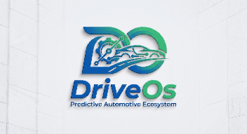

### ***1.1.1. Descripción de la startup*** {#1.1.1.-descripción-de-la-startup}

## **¿Quiénes somos?**

For Devs es un equipo especializado en ingeniería de software dedicado al diseño y desarrollo de soluciones tecnológicas de vanguardia. Nuestro propósito fundamental es resolver desafíos complejos a través de la innovación, construyendo herramientas digitales eficientes, escalables y centradas en el usuario que impulsen la transformación y la innovación en un entorno tecnológico exigente.

El nombre For Devs encapsula la esencia de nuestra identidad y nuestra vocación creadora. Nace de los conceptos Andes, que representa nuestro lugar de origen y el profundo arraigo a la riqueza de la cultura peruana, y Eva, cuyo significado universal es "la que da vida". Juntos, For Devs expresa nuestro compromiso de crear tecnología viva, útil y trascendente desde el Perú hacia el futuro.

## **Misión**

Diseñar y desarrollar soluciones de software innovadoras que empoderen a las organizaciones y a las personas. Buscamos brindar herramientas tecnológicas de primera categoría que optimicen procesos, fomenten la creatividad y resuelvan problemas complejos, garantizando siempre la máxima calidad técnica y una experiencia de usuario excepcional.

## **Visión**

Ser el equipo de ingeniería de software líder y referente tecnológico a nivel internacional, reconocido por nuestra capacidad de innovar y dar vida a productos digitales excepcionales. Aspiramos a construir ecosistemas tecnológicos que definan los estándares del mañana, manteniendo siempre nuestro compromiso inquebrantable con la excelencia y el orgullo por nuestra identidad cultural.

Nuestro principal producto, **DriveOs**, es un ecosistema de software diseñado para transformar radicalmente el modelo operativo tradicional de los talleres automotrices, evolucionando de un enfoque reactivo a uno proactivo, preventivo e inteligente. Más allá de modernizar la gestión diaria, **DriveOs** Workshop funciona como un completo sistema ERP y MRO que otorga al taller control total sobre sus ámbitos administrativos y económicos, logrando fidelizar clientes.

## **¿Qué es y cómo funciona DriveOs?**

El corazón de la innovación de **DriveOs**, que nos permite ofrecer este mantenimiento preventivo, es un software capaz de reconocer e integrarse con cualquier dispositivo OBD2 del mercado. Mediante la telemetría, ya sea conectando OBD2 con tarjeta SIM directa al servidor, o vía Bluetooth/WiFi utilizando el smartphone del conductor como gateway, el sistema anticipa los fallos vehiculares, a través del flujo de datos extraídos o alertas DTC, y automatiza el flujo de servicio.

El ecosistema se divide estratégicamente en dos fases para conectar a todos los actores del proceso; en este caso nos enfocaremos en el desarrollo de DriveOS Workshop:

**DriveOs Workshop:** Una completa aplicación web y móvil orientada al segmento B2B. Con una sólida arquitectura multi-tenant y un estricto control de acceso basado en roles (RBAC), garantiza que cada miembro del equipo, desde el dueño con control global hasta el administrador de sucursal o el mecánico en la zona de trabajo, disponga exactamente de las herramientas e información que necesita para operar con máxima eficiencia.

## Relaciones

- Padre: [[capitulo-i/1.1.startup-profile|1.1. Startup Profile]]
- Índice: [[preliminares/contenido|CONTENIDO]]
