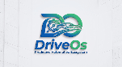
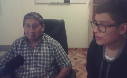
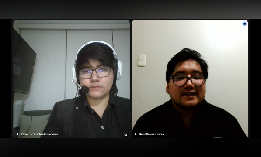
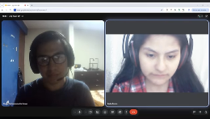

## ***2.1. Competidores*** {#2.1.-competidores}

En esta sección se identifican, analizan y comparan las principales soluciones existentes en el mercado frente a nuestra propuesta de valor DriveOS. Este estudio comparativo permite evaluar las fortalezas, debilidades y modelos operativos de los competidores actuales, con el objetivo de identificar oportunidades estratégicas y ventajas competitivas que permitan resolver eficientemente las necesidades de nuestros segmentos objetivo.

| Competidor | ForkDevs / DriveOS  | Mi Taller CRM | OK CAR | Taller GP |
| ----- | ----- | ----- | ----- | ----- |
| Logo |  |  |  |  |
| Overview | ForkDevs es una startup tecnológica peruana originada en la Universidad Peruana de Ciencias Aplicadas (UPC) en 2026, dedicada a profesionalizar y digitalizar el mantenimiento automotriz mediante datos, transparencia y rentabilidad operativa. Nuestro producto estrella DriveOS es un ecosistema digital integral (web \+ móvil \+ hardware) diseñado para cambiar el paradigma del mantenimiento vehicular de reactivo a predictivo con SUNAT nativo.  | Startup peruano fundada en 2022 en Lima, especializada en digitalizar talleres mecánicos independientes. Resuelve el caos administrativo (papel, Excel, mensajería desordenada) centralizando órdenes de trabajo, inventario y caja en una sola plataforma en la nube.  | Startup mexicano fundada en 2019, líder en Latam con presencia en 6 países (México, Colombia, Perú, Chile, Argentina, Ecuador). Digitaliza talleres medianos y grandes, eliminando el papel y centralizando la operación completa (administrativa \+ comercial).  | Empresa española fundada en 2008 en Valencia, con más de 15 años de trayectoria. ERP robusto para cadenas de talleres y grandes operadores. Resuelve la complejidad administrativa de multi-sucursales con consolidado financiero y control centralizado.  |
| Ventaja competitiva | Somos la única solución en Perú que combina un ERP/MRO multi-tenant con ingesta telemática IoT hardware-agnostic (compatible con cualquier escáner OBD2) para lectura en tiempo real de PIDs y códigos DTC. Ofrecemos facturación electrónica SUNAT nativa (Régimen MYPE), control de inventario bajo principio FIFO estricto por lote, órdenes móviles con respaldo fotográfico inmutable (Direct-to-Cloud) y control de mano de obra verificado por geo cerca perimetral.  | Adaptación 100% a la realidad peruana: facturación electrónica SUNAT nativa, alertas ilimitadas de servicio y soporte local en tiempo real (menos de 2h de respuesta). Su curva de aprendizaje es mínima (menos de 15 min de onboarding).  | App móvil para clientes finales muy pulida (historial del vehículo, citas, pagos en línea) que genera fidelización. Su módulo de "Proyección de Servicios" usa IA básica para predecir mantenimientos por historial, no por telemetría.  | Escalabilidad enterprise: soporta 50+ sucursales con roles granulares, alertas de ITV/mantenimiento preventivo y consultas a la DGT (en España). Certificación de seguridad ISO 27001, algo crítico para cadenas grandes.  |
| Mercado objetivo | Talleres multimarca independientes de pequeño y mediano tamaño (1 a 5 elevadores/bahías) en Lima Metropolitana y principales ciudades del Perú, que atienden vehículos particulares y ligeros (modelo 2008+ con puerto OBD2), con facturación entre S/ 8,000 y S/ 40,000 mensuales y que buscan profesionalizar sus operaciones y diferenciarse con diagnóstico telemétrico proactivo.  | Talleres multimarca independientes de pequeño y mediano tamaño en Lima Metropolitana (1–5 elevadores), que atienden vehículos particulares y motos, con facturación entre S/ 5,000 y S/ 30,000 mensuales.  | Talleres multimarca de mediano y gran tamaño (2–10 elevadores) en zonas urbanas de Latinoamérica, que facturan más de \$8,000 USD mensuales y tienen entre 5 y 20 empleados. | Cadenas de talleres y grupos automotrices (3–50 sucursales) en España y Latinoamérica, que facturan más de €50,000 mensuales y requieren consolidado financiero y control centralizado. |
| Estrategias de marketing | Marketing digital B2B enfocado en gestores de taller, demos en vivo con escaneo telemétrico en tiempo real, alianzas estratégicas con importadoras de scanners OBD2 y repuestos, programa de prueba gratuita de 14 días y programa de referidos. Participación en eventos del sector automotriz y ferias de innovación de la UPC.  | Marketing digital B2B: fuerte presencia en Facebook/Instagram con casos de éxito de talleres locales. Demos gratuitas por Zoom, programa de referidos y SEO en Google.  | Estrategia híbrida: publicidad pagada en Google Ads y Facebook, presencia en ferias automotrices, webinars semanales y programa de embajadores. | Venta consultiva B2B: participación en ferias industriales, partnerships con consultoras de gestión automotriz, casos de estudio de cadenas exitosas. |
| Productos y servicios | Ecosistema multiplataforma (Dashboard Web gerencial \+ App Móvil Offline-First para mecánicos en bahía \+ App Móvil DriveOS para conductores): módulo de ingesta telemática IoT (PIDs y DTCs), ERP completo, facturación electrónica SUNAT nativa (RMT), alertas telemáticas automáticas y medición de tiempos con validación perimetral. | Software web y móvil (responsive) de gestión: órdenes de servicio, inventario, caja, agenda, facturación electrónica SUNAT, alertas de servicio. No incluye hardware OBD2. | Software web y app móvil (iOS/Android) para taller y cliente: órdenes de servicio, inventario, facturación (MX/CO), pasarela de pagos, módulo de lealtad, proyección de servicios. No incluye hardware OBD2. | ERP web (desktop-first): agenda multi-sucursal, órdenes de reparación, facturación, stock avanzado, campañas de marketing, integración con contabilidad externa. No incluye hardware OBD2. |
| Precios y costos | Modelo SaaS por suscripción mensual: Plan Básico desde S/ 149/mes y Plan Pro desde S/ 279/mes. Sin costos ocultos de implementación en planes anuales. | Suscripción mensual desde S/ 129.99 (Plan Básico) hasta S/ 249.99 (Plan Empresarial). Onboarding gratuito. | Suscripción desde \$37 USD/mes hasta \$97 USD/mes. Costo de implementación: \$150 USD. | Precio no publicado (cotización personalizada). Estimado: €80–€200/mes. Implementación: €500–€1.500. |
| Canales de distribución | Modelo 100% SaaS en la nube con ventas directas digitales B2B (sitio web oficial forkdevs.pe, demos por Zoom/Google Meet) y canal de venta consultiva. | 100% SaaS (nube). Venta directa digital \+ demos por Zoom. | SaaS en la nube con venta híbrida: web directa \+ distribuidores locales. | SaaS en la nube con venta consultiva (demo \+ cotización). |
| SWOT \- Fortalezas | \- Plataforma ERP/MRO 100% peruana con integración telemática IoT hardware-agnostic. \- Facturación electrónica SUNAT nativa. \- Respaldo fotográfico inmutable Direct-to-Cloud. \- Valorización de inventario contable bajo principio FIFO. \- Interfaces adaptadas por rol (Web \+ Mobile App Offline-First). | \- Marca 100% peruana con soporte local en tiempo real. \- Facturación electrónica SUNAT 100% integrada. \- \+80 talleres activos en Lima. \- Interfaz muy intuitiva. | \- Presencia en 6 países. \- App móvil muy pulida para clientes. \- Módulo de Proyección de Servicios. \- Capacitación ilimitada. | \- ERP enterprise-grade (50+ sucursales). \- Alertas de ITV/Mantenimiento preventivo. \- Integración con contadores externos. \- \+15 años en el mercado. |
| SWOT \- Debilidades | \- Startup en etapa inicial. \- Presupuesto de marketing inicial acotado frente a competidores internacionales. \- Requiere un proceso inicial de capacitación para mecánicos. | \- Cero integración con hardware OBD2. \- Módulo de contabilidad básico. \- Sin app nativa móvil. \- Sin IA para diagnósticos. | \- Sin integración OBD2. \- Facturación electrónica no adaptada a SUNAT. \- Soporte en horario extranjero. \- Interfaz sobrecargada para talleres pequeños. | \- Enfoque 100% administrativo. \- Precio alto para talleres independientes. \- Sin facturación electrónica SUNAT. \- Implementación lenta. |
| SWOT \- Oportunidades | \- Crecimiento acelerado del parque automotor con puerto OBD2 (post-2008). \- Demanda creciente de digitalización y formalización SUNAT. \- Alianzas con aseguradoras y flotas. \- Acceso a fondos de innovación y aceleradoras (UPC Launchpad). | \- Crecimiento de vehículos híbridos / eléctricos. \- Adopción masiva de Yape/Plin. \- Alianzas con aseguradoras. | \- Expandir a talleres de cadena en Perú. \- Integrar pasarelas locales. \- Alianzas con importadoras de scanners OBD2. | \- Crecimiento de cadenas de talleres en Lima. \- Demanda de ERPs multi-sucursal. \- Alianzas con aseguradoras. |
| SWOT \- Amenazas | \- Competidores locales/regionales que adopten módulos telemétricos o bajen precios. \- Cambios imprevistos en normativas SUNAT. \- Resistencia cultural al cambio por parte de dueños tradicionales. | \- Entrada de DriveOS con OBD2 \+ SUNAT nativo. \- Cambios bruscos en la normativa SUNAT. \- Competidores internacionales bajando precios. | \- ForkDevs con ingesta telemática IoT \+ SUNAT nativo. \- Fortalecimiento de competidores locales. \- Devaluación del sol frente al USD. | \- ForkDevs con modelo más ágil y adaptado para el mercado peruano. \- Competidores locales escalando a multi-sucursal. \- Brecha horaria de soporte. |

**2.1.1 Estrategias y tácticas frente a competidores**

| Competidores | Táctica diferenciadora | Fortalezas del rival que enfrentamos | Debilidad rival que aprovecharemos |
| :---- | :---- | :---- | :---- |
|  | Ellos se posicionan como la opción 100% peruana y la más fácil de usar: "En 15 minutos tu taller está digitalizado. Su gancho es la inmediatez (sin implementación larga) y el soporte local en tiempo real que responde en menos de 2 horas. | Adaptación total a SUNAT y confianza local: Llevan 4 años (2022–2026) en el mercado peruano con \+80 talleres activos. Su facturación electrónica nunca falla porque la actualizan con cada cambio de la SUNAT. | Somos técnicos, ellos solo administrativos: Mi Taller CRM solo gestiona papeles, pero no se conecta al vehículo. El mecánico sigue usando su escáner OBD2 por separado. DriveOS elimina ese paso manual capturando datos telemétricos directamente. |
|  | Ellos se venden como la plataforma más completa para crecer: "Lleva tu taller a otro nivel". Su gancho es la app móvil para clientes finales y su módulo de "Proyección de Servicios*"* basado en historial. | Presencia regional y app pulida: Operan en 6 países con miles de talleres, lo que les da economías de escala para invertir en una app móvil muy bien diseñada y capacitación continua. | Su "predictivo" es falso, el nuestro es real: La "Proyección de Servicios" de OK CAR solo predice según la última visita, no lee datos reales del auto en tiempo real. Además, no tienen facturación electrónica para SUNAT. |
|  | Ellos se venden como el ERP enterprise para cadenas que quieren control total: "Gestiona 50 talleres como si fuera uno solo". Su gancho es la escalabilidad y el consolidado financiero. | Trayectoria de más de 15 años y robustez: Llevan desde 2008 en el mercado, con certificación ISO 27001 de seguridad y clientes enterprise (cadenas de 20 \- 50 sucursales). | Son lentos, caros y nosotros ágiles, baratos y predictivos: Su implementación toma 2 \- 4 semanas y cuesta €500 \- €1.500. Además, no hacen diagnóstico técnico ni cuentan con facturación SUNAT. |

**2.2. Entrevistas**

En esta sección se detalla el diseño metodológico de las guías de entrevista estructuradas por bloques temáticos, dirigidas a validar las necesidades, fricciones operativas y la disposición de adopción tecnológica de los dos segmentos de clientes B2B definidos en el proyecto.

***2.2.1. Diseño de Entrevistas***

El diseño de las entrevistas se organizó por bloques temáticos de acuerdo con las características y actividades de cada segmento. Las preguntas permiten conocer su contexto de trabajo, procesos actuales, principales dificultades y uso de herramientas tecnológicas dentro del taller.

**2.2.1.1. Matriz de Alineación del Diseño de Entrevistas**

2.2.1.1.1. Segmento 1: Personal de Gestión y Propietarios del Taller (Decisores B2B)

| Bloque Temático | Objetivo de Investigación | Artefacto / Módulo Impactado |
| :---- | :---- | :---- |
| Bloque 1: Datos Demográficos | Caracterizar el perfil del decisor y contexto operativo del taller. | User Persona (Gestor B2B) |
| Bloque 2: Operatividad y Cuellos de Botella | Identificar fricciones y tiempos muertos en la gestión de órdenes. | As-Is Scenario Mapping |
| Bloque 3: Inventario y Finanzas | Evaluar pérdidas por descontrol de stock y costeo empírico vs FIFO. | Módulo FIFO & Rentabilidad |
| Bloque 4: Facturación y SUNAT | Analizar el nivel de formalización tributaria y tiempos de liquidación. | Facturación SUNAT Nativa |
| Bloque 5: Telemetría y Adopción | Validar la disposición de pago por diagnóstico predictivo IoT OBD2. | Ecosistema SaaS Proactivo |

2.2.1.1.2. Segmento 2: Personal Operativo del Taller (Técnicos Mecánicos en Bahía)

| Bloque Temático | Objetivo de Investigación | Artefacto / Módulo Impactado |
| :---- | :---- | :---- |
| Bloque 1: Perfil Técnico | Identificar nivel de alfabetización digital y uso de smartphones. | User Persona (Técnico B2B) |
| Bloque 2: Recepción y Diagnóstico | Evaluar el tiempo de diagnóstico e interpretación de códigos DTC. | Ingesta Telemática PIDs/DTCs |
| Bloque 3: Trazabilidad y Evidencia | Identificar vulnerabilidad ante disputas por daños preexistentes. | Respaldo Fotográfico Direct-to-Cloud |
| Bloque 4: Conectividad y Entorno | Evaluar la necesidad de funcionamiento continuo sin internet. | Arquitectura Offline-First |
| Bloque 5: Tiempos e Incentivos | Medir la transparencia en la remuneración por productividad. | Control por Geocerca |

**2.2.1.2. Guía de Entrevistas** 

2.2.1.2.1. Segmento 1: Personal de Gestión y Propietarios del Taller (Decisores B2B)

*Objetivo General*: Identificar cómo gestionan administrativamente el taller, los métodos de control de inventario y costeo de repuestos, las dificultades de facturación/formalización tributaria ante SUNAT y su disposición a adoptar un modelo de mantenimiento predictivo vía telemetría.

Bloque 1: Datos Demográficos y Contexto del Negocio

1. ¿Cuál es su nombre, edad y cargo dentro del taller?

2. ¿Cuántos años lleva operando el taller y cuántas bahías/elevadores y personal técnico tiene a su cargo?

3. ¿Cuál es el promedio mensual de vehículos que ingresan y qué tipo de clientes atienden mayoritariamente (particulares, flotas comerciales, empresas)?

4. ¿Qué herramientas o software utiliza actualmente para administrar el negocio (cuadernos físicos, Excel, ERP, WhatsApp, otro)?

Bloque 2: Operatividad Diaria y Cuellos de Botella 

5. ¿Cómo es el proceso desde que un cliente llega al taller hasta que se aprueba y finaliza una orden de trabajo? 

6. ¿Cuáles son los principales motivos de retraso en la entrega de vehículos y cómo maneja las quejas de clientes por tiempos no cumplidos? 

7. ¿Cómo realiza la asignación de vehículos y el control de la carga de trabajo entre sus técnicos mecánicos?

Bloque 3: Control de Inventario, Costeo y Finanzas 

8. ¿Cómo registra y valoriza el stock de repuestos e insumos en su almacén? ¿Aplica algún método formal de costeo (como FIFO) o un cálculo empírico? 

9. ¿Ha experimentado pérdidas económicas por descontrol de stock, mermas o repuestos utilizados cuyo costo real no fue cobrado al cliente? ¿Con qué frecuencia ocurre? 

10. ¿Cómo calcula el margen de ganancia neto real de cada servicio prestado considerando el costo exacto del repuesto y la mano de obra?

Bloque 4: Facturación, Formalización y Relación con el Cliente

11. ¿Cómo maneja la emisión de comprobantes de pago electrónicos ante la SUNAT y cuánto tiempo le toma liquidar una orden de trabajo? 

12. ¿Qué porcentaje de sus clientes regresa de forma periódica para mantenimientos preventivos frente a los que solo acuden cuando el vehículo ya presenta una avería grave? 

13. ¿Qué canales utiliza para comunicarse con sus clientes y cómo les notifica el presupuesto o el avance de la reparación?

Bloque 5: Telemetría, Innovación y Adopción Tecnológica

14. ¿Conoce o ha evaluado la posibilidad de monitorear de forma remota el estado mecánico del vehículo de sus clientes mediante dispositivos OBD-II? 

15. Si existiera una plataforma en la nube que le permita anticipar fallas mecánicas de sus clientes antes de que ocurran, controlar su inventario bajo FIFO y facturar electrónicamente en menos de 2 minutos, ¿qué valor le aportaría a su taller y qué le preocupa respecto a su costo o curva de aprendizaje?

2.2.1.2.2. Segmento 2: Personal Operativo del Taller (Técnicos Mecánicos en Bahía)

*Objetivo General*: Explorar el flujo de inspección y diagnóstico vehicular, las fricciones al interactuar con órdenes de trabajo físicas, la vulnerabilidad ante reclamos por daños preexistentes y la necesidad de una herramienta móvil ágil con soporte Offline-First.

Bloque 1: Datos Demográficos y Perfil Técnico

1. ¿Cuál es su nombre, edad y cuántos años de experiencia tiene trabajando en mecánica automotriz?

2. ¿Cuenta con formación técnica superior (Senati, Tecsup, etc.) o su aprendizaje ha sido empírico?

3. ¿Qué tipo de dispositivo móvil utiliza diariamente en el taller (sistema operativo, tamaño de pantalla, uso con guantes o manos con grasa)?

Bloque 2: Proceso de Recepción, Diagnóstico y Escaneo

4. Cuando ingresa un vehículo a su bahía de trabajo, ¿cuál es el procedimiento que sigue para realizar el diagnóstico preliminar? 

5. ¿Utiliza escáneres automotrices OBD-II multimarca en su trabajo diario? ¿Qué marcas o modelos suele emplear y qué dificultades encuentra al interpretar códigos DTC o parámetros en vivo? 

6. ¿Cuánto tiempo le toma en promedio identificar la causa raíz de una avería y plasmar el diagnóstico en la orden de servicio?

Bloque 3: Trazabilidad, Evidencia y Disputas con Clientes

7. Al recibir un vehículo, ¿cómo registra el estado estético inicial (rayones, golpes, pertenencias en el auto)? ¿Se utiliza registro fotográfico o formatos en papel?

8. ¿Alguna vez ha tenido reclamos injustificados por parte de clientes acusándolo de haber dañado una pieza o de no haber realizado un reemplazo? ¿Cómo se defendió frente a esa situación? 

9. ¿Consideraría útil contar con una aplicación móvil que permita tomar fotos inmutables del estado del auto y subirlas directamente a la orden de trabajo digital en la nube?

Bloque 4: Conectividad y Condiciones del Entorno de Trabajo

10. ¿En las fosas de trabajo, elevadores o áreas cerradas del taller cuenta con buena cobertura de internet Wi-Fi o datos móviles? 

11. Si una aplicación móvil se quedara sin señal a mitad del registro de un diagnóstico o servicio, ¿Qué impacto tendría en su ritmo de trabajo? ¿Qué tan indispensable considera que funcione sin conexión a internet (Offline-First)? 

12. ¿Qué características debería tener una interfaz móvil para que no le resulte incómoda o pesada de usar mientras trabaja en el vehículo?

Bloque 5: Gestión del Tiempo y Esquemas de Incentivos

13. ¿Cómo registra actualmente el tiempo efectivo de mano de obra dedicado a cada reparación? 

14. ¿Su remuneración incluye algún tipo de bono o incentivo basado en productividad u órdenes terminadas? ¿Considera que el sistema actual es transparente o se presta a confusiones? 

15. ¿Cómo evaluaría una herramienta que mida sus tiempos reales de trabajo y le permita justificar de forma automática su productividad para bonificaciones meritocráticas?

***2.2.2. Registro de entrevistas***

**2.2.2.1. Segmento 1: Personal de Gestión y Propietarios del Taller**

2.2.2.1.1. Entrevista a Roberto García Sánchez

| Evidencia Audiovisual | Ficha técnica de registro |
| :---- | :---- |
|  *Nota*: Entrevista a Roberto García | *Nombres y Apellidos*: Roberto García Sánchez*Segmento Objetivo*: Personal de Gestión y Propietarios (Decisores B2B)*Cargo / Puesto*: Encargado de Mantenimiento y Gestión*Tipo de Taller*: Taller mecánico independiente (MYPE / Pequeña Empresa)*Personal a Cargo*: 2 técnicos mecánicos especializados*Entrevistador*: Ayala Fernandez, Jorge Brayan*Fecha*: 07/09/2026*Tiempo / Video*: 00:00:05 – 00:19:23 |

Link: [https\://tinyurl.com/nfchyns5](https://tinyurl.com/nfchyns5)

**Resumen de la Entrevista**

Roberto García Sánchez, encargado de mantenimiento en un taller mecánico clasificado como pequeña empresa (MYPE), coordina a dos trabajadores técnicos especializados en áreas como mecánica de motor, inyección, alineamiento, electricidad, frenos, chasis y planchado/pintura. Destaca que la gestión interna del negocio se realiza de forma totalmente manual mediante anotaciones en cuadernos físicos, donde se registran y controlan las tareas según los horarios de los operarios, las compras de repuestos (como chips, bujías o cables) y el inventario disponible en depósito.

El flujo operativo inicia con el escaneo del computador del vehículo para detectar la falla técnica exacta y derivar el automóvil al área correspondiente. Posteriormente, acuerda con el cliente el tipo de repuesto a utilizar evaluando tres gamas de calidad (baja, intermedia y máxima) con su respectivo presupuesto. La disponibilidad de repuestos condiciona directamente los tiempos de entrega: si la pieza está en stock en depósito la reparación es inmediata, pero si debe solicitarse al proveedor el proceso puede demorar de uno a dos días hábiles. Para evitar confusiones en pedidos y costos, el personal fotografía la pieza extraída y la envía digitalmente al proveedor.

En el ámbito tributario y contable, el área pertinente emite boletas de venta para clientes comunes y facturas electrónicas con el 18% de IGV cuando son solicitadas por empresas, registrando las compras y ventas correspondientes. Respecto al alcance del servicio, precisa que los siniestros mayores derivados de choques o volcaduras extremas no forman parte del mantenimiento ordinario, sino que se derivan al área de planchado y mecánica para reconstrucción o desarme total.

Finalmente, aunque la interacción con los clientes sigue siendo predominantemente presencial debido a que prefieren inspeccionar las fallas personalmente al dejar el coche, el taller adopta como apoyo digital el envío de fotos o videollamadas para mostrar repuestos dañados. Roberto considera que cualquier inversión o presupuesto tecnológico debe integrarse de forma natural dentro de los costos de mantenimiento para mejorar la experiencia del cliente y la rentabilidad del taller.

**Conclusiones clave**

| Aspecto clave | Lección aprendida para la Arquitectura de DriveOS |
| :---- | :---- |
| Digitalización MRO | Sustituir cuadernos físicos por control digital de órdenes, agendas e inventario. |
| Catálogo por Gamas | Implementar presupuestación de repuestos por gamas de calidad (baja, media, alta). |
| Gestión Logística | Integrar envío de fotos de piezas dañadas directamente a proveedores desde la app. |
| Facturación SUNAT | Soporte nativo para emisión inmediata de boletas y facturas electrónicas con IGV. |

**2.2.2.2. Segmento 2: Personal Operativo del Taller**

2.2.2.2.1. Entrevista a Kevin Ramírez Torres

| Evidencia Audiovisual | Ficha técnica de registro |
| :---- | :---- |
|  *Nota*: Entrevista a Kevin Ramírez | *Nombres y Apellidos*: Kevin Ramírez Torres*Segmento Objetivo*: Personal Operativo del Taller (Técnicos Mecánicos)*Edad / Ubicación*: 28 años | Jesús María, Lima*Cargo / Puesto*: Técnico en Mecatrónica Automotriz*Formación*: Egresado de SENATI*Experiencia*: 7 años en taller multimarca*Entrevistador*: Barrenechea Bustamante, Rafael Andre*Fecha*: 07/09/2026*Tiempo / Video*: 00:00:05 – 00:11:53 |

Link: [https\://www\.youtube.com/watch?v=EuM09QvunOU](https://www.youtube.com/watch?v=EuM09QvunOU)

**Resumen de la Entrevista**

Kevin Ramírez Torres (28 años), técnico en Mecatrónica Automotriz egresado de SENATI con 7 años de experiencia en un taller independiente multimarca, compartió información clave sobre la operatividad diaria en bahía. Destacó que utiliza diariamente un smartphone Android para comunicarse y tomar fotos, pero enfatizó que la manipulación del teléfono con guantes o manos con grasa dificulta la escritura extensa; por ello, una aplicación móvil para el técnico debe priorizar botones grandes, alto contraste y muy pocos toques.

Respecto al diagnóstico vehicular, inicia con la recepción del problema reportado, inspección visual y conexión de escáner OBD-II multimarca. Resaltó que los códigos DTC y parámetros en vivo son herramientas de orientación fundamentales, pero nunca deben sustituir el criterio profesional del técnico. La ingesta automática de códigos hacia la orden de trabajo reduciría tareas repetitivas, siempre que el mecánico conserve la responsabilidad final de confirmación.

En relación a la trazabilidad, señaló que actualmente las fotos de recepción quedan en la galería del teléfono o en WhatsApp sin asociarse formalmente a la orden de servicio. Validó la necesidad de contar con un registro fotográfico inmutable al momento del ingreso para blindar al taller ante reclamos por daños preexistentes.

Sobre conectividad, confirmó que las zonas cerradas o fosos del taller tienen cobertura inestable de Wi-Fi y datos. Ante una pérdida de señal, el técnico regresaría al papel si la app se bloquea, por lo que considera indispensable una arquitectura Offline-First. En cuanto a la gestión del tiempo, valoró positivamente el cronometraje de mano de obra por tarea siempre que sea transparente y respalde bonos de productividad, evitando que se perciba como vigilancia.

**Conclusiones clave**

| Aspecto clave | Lección aprendida para la Arquitectura de DriveOS |
| :---- | :---- |
| UX en Bahía | Priorizar interacción táctil simplificada y libre de tipeo extenso. |
| Telemetría IoT | Presentar datos telemétricos como recomendación con verificación del técnico. |
| Resiliencia Técnica | Implementar base de datos local y sincronización asíncrona Offline-First. |
| Blindaje Legal | Captura fotográfica directa desde el móvil hacia la orden en la nube. |

2.2.2.2.2. Entrevista a Diego Manuel

| Evidencia Audiovisual | Ficha técnica de registro |
| :---- | :---- |
|  *Nota*: Entrevista a Diego Manuel | *Nombres y Apellidos*: Diego Manuel*Segmento Objetivo*: Personal Operativo del Taller (Técnicos Mecánicos)*Edad / Ubicación*: 22 años | No especificado*Cargo / Puesto*: Técnico en Mecánica Automotriz*Formación*: Instituto Gamor*Experiencia*: Casi 2 años en taller de mecánica automotriz*Entrevistador*: Torres Sanchez, Dalila Victoria*Fecha*: 07/09/2026*Tiempo / Video*: 00:00:04 – 00:18:41 |

Link: [https\://www\.youtube.com/watch?v=JfLLjH7Tbc8](https://www.youtube.com/watch?v=JfLLjH7Tbc8)

**Resumen de la Entrevista**

Diego Manuel, un joven de 22 años con cerca de dos años de experiencia en mecánica automotriz y formación en el Instituto Gamor, se desempeña en un taller pequeño con capacidad para sólo dos vehículos, lo que obliga a realizar algunos trabajos en la vía pública. El establecimiento opera de manera tradicional con cinco mecánicos y un equipamiento totalmente manual, prescindiendo de herramientas automáticas, red Wi-Fi e instrumentos de diagnóstico electrónico como escáneres OBD2. Toda la evaluación de fallas se ejecuta de forma empírica desarmando componentes del motor, un proceso que para averías complejas puede demorar horas o días, mientras que la comunicación con los clientes y la coordinación interna se sostienen mediante el uso de datos móviles de los propios trabajadores y llamadas telefónicas.

En cuanto al flujo de recepción y atención al cliente, el personal suele tomar fotografías preventivas con sus teléfonos particulares para registrar el estado estético del vehículo y evitar falsos reclamos por rayones o daños preexistentes. Diego menciona disputas recientes, como el fallo en una cadena de distribución recién instalada, donde el cliente culpó a la mecánica y el equipo tuvo que defender su trabajo argumentando que el repuesto empleado era completamente nuevo. La gestión de los servicios se organiza según la gravedad de la avería, asignando un técnico para tareas sencillas o combinando el esfuerzo de dos mecánicos cuando la reparación es severa o el cliente requiere con urgencia su medio de transporte o trabajo.

Respecto al esquema laboral, la remuneración consiste en un sueldo fijo mensual sin bonos, incentivos por productividad ni compensaciones meritocráticas, enfocando sus esfuerzos en la satisfacción del cliente para garantizar la recurrencia y la rentabilidad del negocio. A pesar de trabajar con un modelo antiguo, el entrevistado evalúa positivamente la incorporación de un software de medición de tiempos y registros de trabajo, pues considera que disponer de evidencias objetivas sobre la cantidad y eficacia de las reparaciones completadas serviría como sustento técnico para negociar futuros incrementos salariales o bonificaciones a medida que el taller se modernice.

Finalmente, Diego muestra una buena disposición hacia el uso de aplicaciones móviles operativas, enfatizando la importancia de que la interfaz sea sumamente intuitiva, clara y libre de menús recargados, utilizando íconos grandes y legibles para tomar fotografías, ingresar placas y registrar comentarios rápidamente. Además, señala que una hipotética pérdida de conexión a internet o la falta de un modo sin conexión no interrumpiría el ritmo productivo del taller, ya que al ejecutar las tareas técnicas con herramientas convencionales, la labor mecánica se mantiene independiente de las plataformas digitales.

**Conclusiones clave**

| Aspecto clave | Lección aprendida para la Arquitectura de DriveOS |
| :---- | :---- |
| Arquitectura Offline-First | Permitir la captura de datos y fotos de forma local sin conexión a internet, sincronizando automáticamente en segundo plano cuando haya cobertura de datos móviles. |
| Gestión eficiente de imágenes | Comprimir automáticamente las fotografías tomadas al vehículo en el dispositivo antes de subirlas a la nube para ahorrar almacenamiento y datos. |
| Interfaz ultra simplificada (UI/UX) | Diseñar una pantalla con íconos grandes, botones visibles y texto mínimo para facilitar su uso rápido con manos ocupadas o sucias. |
| Módulo de marcado de tiempo simple | Incluir un sistema rápido de inicio/fin de tareas por vehículo para registrar tiempos de trabajo y productividad sin añadir carga administrativa. |

##

## Relaciones

- Padre: [[capitulo-ii/capitulo-ii-requirements-analysis|Capítulo II: Requirements  & Analysis]]
- Índice: [[preliminares/contenido|CONTENIDO]]
