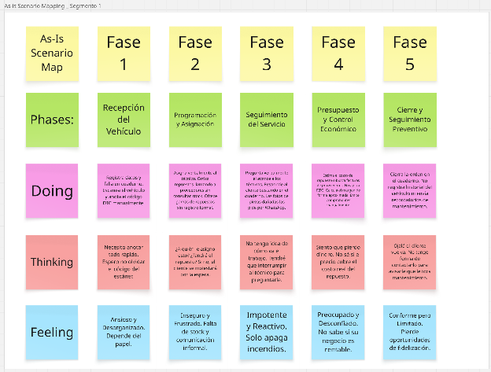

#### ***2.3.4.1. As-Is Scenario Map del Gestor o Propietario del Taller*** {#2.3.4.1.-as-is-scenario-map-del-gestor-o-propietario-del-taller}

El análisis evidencia que el gestor opera bajo un modelo de gestión predominantemente reactivo, caracterizado por la ausencia de un sistema centralizado de información. Esta carencia genera una pérdida de control y visibilidad sobre las operaciones y las finanzas del taller, obligando a la toma de decisiones basada en la intuición. Como consecuencia directa, se identifican fugas de capital asociadas al costeo empírico de repuestos, una disminución en la retención de clientes debido a demoras en la comunicación y una incapacidad estructural para implementar estrategias de mantenimiento proactivo.

[**https\://miro.com/app/board/uXjVHljlF0s=/?share\_link\_id=420555761614**](https://miro.com/app/board/uXjVHljlF0s=/?share_link_id=420555761614)
