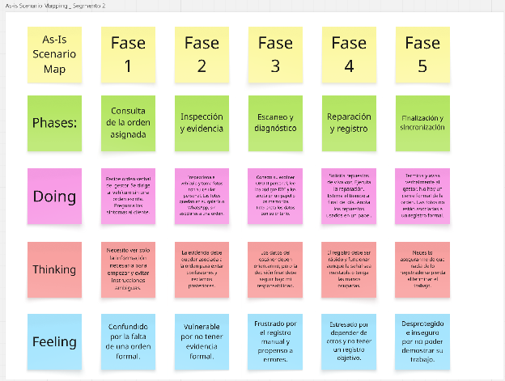

#### ***2.3.4.2. As-Is Scenario Map del Técnico Mecánico*** {#2.3.4.2.-as-is-scenario-map-del-técnico-mecánico}

****

El análisis revela que el técnico mecánico desempeña sus funciones en un entorno operativo con un alto grado de fricción y dependencia de procesos analógicos. A pesar de contar con competencias digitales y herramientas tecnológicas personales, la ausencia de una plataforma integrada que articule su flujo de trabajo con el resto del taller genera duplicidad de tareas, pérdida de evidencia crítica para la trazabilidad y una percepción de falta de reconocimiento formal de su productividad. Esta situación lo expone a una vulnerabilidad operativa y legal significativa.

## Relaciones

- Padre: [[capitulo-ii/2.3.4.as-is-scenario-mapping|2.3.4. As-Is Scenario Mapping]]
- Índice: [[preliminares/contenido|CONTENIDO]]
