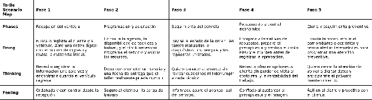

### ***3.1.1. To-Be Scenario Map del gestor o propietario del taller***

*To-Be Scenario Map del gestor o propietario del taller*

El cambio principal para el gestor consiste en utilizar una sola orden como fuente de información durante toda la atención. La programación se apoya en la disponibilidad real de técnicos y bahías; el seguimiento incorpora diagnóstico, tiempos, evidencias y repuestos; y la liquidación reutiliza los datos ya registrados. Con ello se reduce la necesidad de revisar cuadernos o solicitar actualizaciones individuales para conocer el estado del taller.

Link: [https\://miro.com/app/board/uXjVHnzdN\_M=/?share\_link\_id=411604306283](https://miro.com/app/board/uXjVHnzdN_M=/?share_link_id=411604306283)

## Relaciones

- Padre: [[capitulo-iii/3.1.to-be-scenario-mapping|3.1. To-Be Scenario Mapping]]
- Índice: [[preliminares/contenido|CONTENIDO]]
