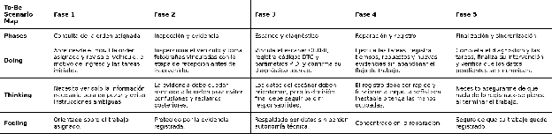

### ***3.1.2. To-Be Scenario Map del técnico mecánico***

*To-Be Scenario Map del técnico mecánico*

Para el técnico, el escenario futuro concentra la información operativa en una vista móvil. La lectura OBD-II se incorpora a la orden sin sustituir la validación profesional, las fotografías quedan asociadas al momento de la atención y el registro de tareas y tiempos puede continuar cuando la conexión es inestable. Al finalizar, la aplicación distingue la información sincronizada de la que todavía está pendiente.

Link: [https\://miro.com/app/board/uXjVHnzdN\_M=/?share\_link\_id=411604306283](https://miro.com/app/board/uXjVHnzdN_M=/?share_link_id=411604306283)
