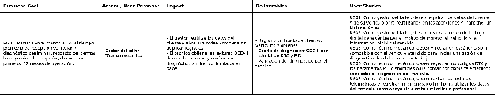

## ***3.3. Impact Map***

El Impact Map vincula las métricas planteadas en los Business Outcome Assumptions y Hypothesis Statements con los dos User Persona del proyecto. Para que los objetivos sean específicos, medibles y temporales, se utiliza como horizonte común los primeros 12 meses de operación definidos en el proyecto. Cada rama responde a cinco elementos: Business Goal, Actor o User Persona, Impact esperado, Deliverables y User Stories que permiten construir esos entregables.

Link: [Impact Map](https://drive.google.com/file/d/1NJDShZ4jFeFqDQQw4-y2fEaMptx2971P/view?usp=sharing)

*Impact Map BG01 de DriveOS Workshop*

*Impact Map BG02 de DriveOS Workshop*

*Impact Map BG03 de DriveOS Workshop*

*Impact Map BG04 de DriveOS Workshop*

*Impact Map BG05 de DriveOS Workshop*

*Impact Map BG06 de DriveOS Workshop*

*Impact Map BG07 de DriveOS Workshop*

*Impact Map BG08 de DriveOS Workshop*

## Relaciones

- Padre: [[capitulo-iii/capitulo-iii-requirements-specification|CAPÍTULO III: Requirements Specification]]
- Índice: [[preliminares/contenido|CONTENIDO]]
