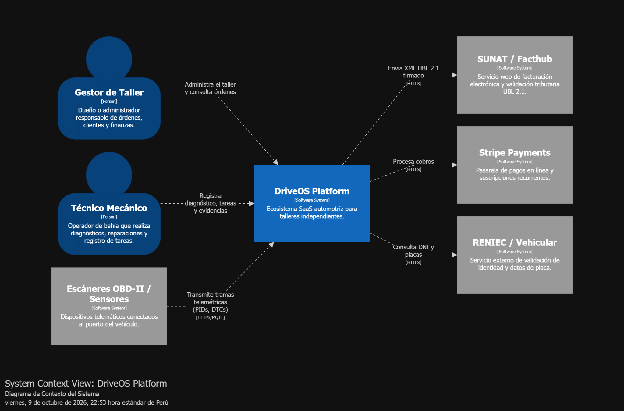

### ***4.1.3. Context Diagram*** {#4.1.3.-context-diagram}

El diagrama de contexto define las fronteras del sistema DriveOS Platform, modelando las interacciones entre los actores del taller y los sistemas externos que habilitan su operación integral. Diseñado bajo el estándar C4 Model (Nivel 1\) mediante Structurizr, el diagrama establece los siguientes límites de interacción: 

**• Sistema Principal:**

\- DriveOS Platform: Ecosistema SaaS automotriz central que digitaliza la operación de talleres mecánicos independientes, coordinando la gestión operativa y el diagnóstico predictivo.

**• Actores / Personas:**

\- Gestor de Taller: Dueño o administrador del negocio automotriz que administra el taller, supervisa el inventario, aprueba presupuestos y consulta el estado global de las órdenes de trabajo.

\- Técnico Mecánico: Operador de bahía en taller que realiza la inspección física, vincula el escáner, ejecuta diagnósticos y registra tareas y evidencias operativas.

**• Sistemas Externos / Integraciones:**

\- SUNAT / Facthub: Servicio web para la validación tributaria y emisión de comprobantes de pago electrónicos bajo el estándar XML UBL 2.1.

\- Stripe Payments: Pasarela de pagos digitales para el cobro de servicios de taller y administración de suscripciones recurrentes de la plataforma SaaS.

\- RENIEC / Consulta Vehicular: Servicio externo para la verificación de identidad de clientes y validación de datos técnicos de vehículos mediante placa de rodaje y número VIN.

\- Escáneres OBD-II / Sensores: Dispositivos telemáticos conectados al puerto estándar del vehículo que transmiten tramas de datos (PIDs) y códigos de falla (DTCs) en tiempo real.

## Relaciones

- Padre: [[capitulo-iv/4.1.design-concepts-viewpoints-er-diagrams|4.1. Design Concepts, ViewPoints & ER Diagrams]]
- Índice: [[preliminares/contenido|CONTENIDO]]
