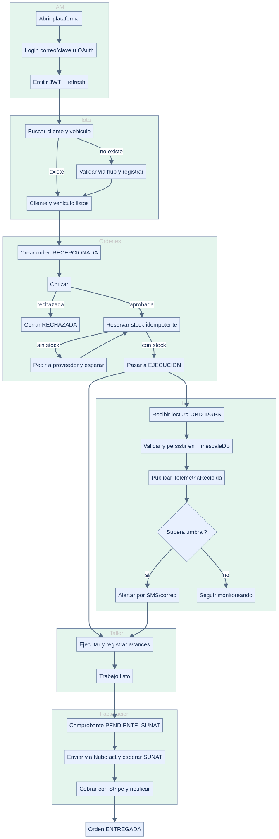

#### ***4.1.4.1. Diagrama de Actividad UML*** {#4.1.4.1.-diagrama-de-actividad-uml}

Se presenta el diagrama de actividades que describe el flujo principal cuando un asesor recibe un vehículo, registra la orden, el taller la ejecuta con apoyo de telemetría y finalmente factura. El diagrama organiza las acciones en los contextos más relevantes: IAM, Flota, Órdenes, Inventario, Facturación (con lógica propia vía Nubefact), IoT/Analítica y Notificaciones.

El recorrido se inicia en IAM, donde el asesor abre la plataforma e inicia sesión con correo y contraseña o con autenticación federada (Google OAuth). El sistema valida las credenciales, emite un Token Web JSON (JSON Web Token, JWT) de acceso corto más token de refresco, y redirige al panel del taller.

Una vez autenticado, el control pasa a Flota, que busca al cliente por documento y al vehículo por placa/VIN. Si no existen, los registra validando identidad contra RENIEC y datos vehiculares a través del hub (con caché y reintento para no frenar la recepción). Con cliente y vehículo listos, el flujo continúa en Órdenes: se crea la orden de trabajo en estado recepcionada, se registra el diagnóstico inicial y se genera la cotización (repuestos \+ mano de obra).

Con la cotización aprobada por el cliente, Órdenes solicita reserva de stock a Inventario por llamada idempotente; si no hay stock, se genera pedido a proveedor y la orden espera; si hay, se descuenta y la orden pasa a ejecución, donde el mecánico registra avances. En paralelo, IoT recibe las lecturas del dispositivo OBD-II/GPS, las valida y normaliza, las asocia al vehículo, las persiste en series de tiempo (TimescaleDB) y publica el evento TelemetriaRecibida al bus (Kafka). Analítica lo consume: actualiza indicadores del vehículo, evalúa umbrales y, si algo supera lo configurado (ej. temperatura), genera alerta que Notificaciones envía por SMS/correo.

Al terminar el trabajo, Órdenes marca la orden como lista y Facturación emite el comprobante con numeración propia en estado PENDIENTE\_SUNAT, lo envía vía Nubefact y queda a la espera de aceptación; el cliente paga por Stripe y recibe su comprobante por correo. Finalmente el panel muestra la orden entregada con su historial, y el asesor puede cerrar sesión en IAM, concluyendo el proceso.

**Diagrama de actividad**  

