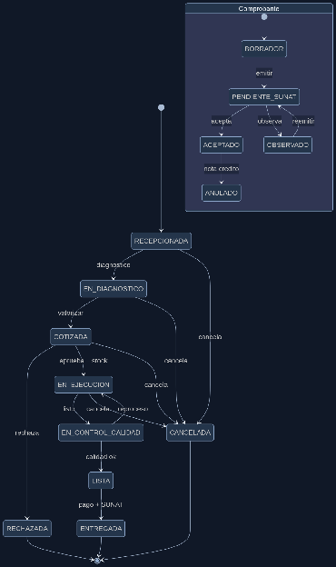

#### ***4.1.4.2. Diagrama de Estado UML*** {#4.1.4.2.-diagrama-de-estado-uml}

La orden nace RECEPCIONADA, pasa a EN\_DIAGNOSTICO al registrar hallazgos, a COTIZADA al valorizar, y espera aprobación: si el cliente rechaza va a RECHAZADA (final); si aprueba y hay stock va a EN\_EJECUCION, luego a EN\_CONTROL\_CALIDAD, a LISTA y a ENTREGADA (final) tras pago y facturación aceptada. Desde cualquier estado intermedio puede ir a CANCELADA (final) con compensación (liberar stock reservado). En paralelo, el comprobante nace BORRADOR, pasa a PENDIENTE\_SUNAT al emitirse con numeración propia, y SUNAT vía Nubefact lo deja en ACEPTADO (final) u OBSERVADO (corrige y reemite); un aceptado aún puede pasar a ANULADO con nota de crédito.

**Diagrama de estado**

## Relaciones

- Padre: [[capitulo-iv/4.1.4.approach-driven-viewpoints-diagrams-2|4.1.4. Approach driven ViewPoints Diagrams]]
- Índice: [[preliminares/contenido|CONTENIDO]]
