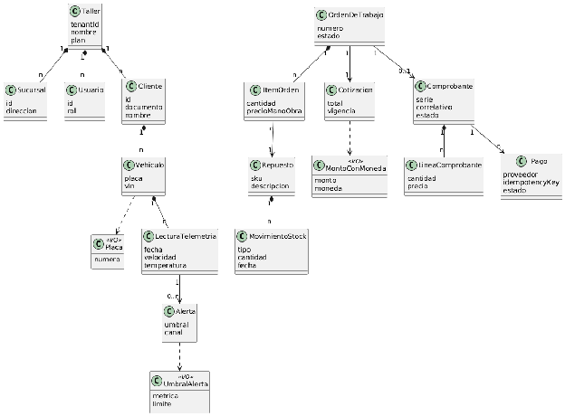

#### ***4.1.4.3. Diagrama de Clases UML*** {#4.1.4.3.-diagrama-de-clases-uml}

**Modelado centrado en el dominio:** Un Taller (tenant) tiene Sucursal, Usuario y Vehículo a través de Cliente; la OrdenDeTrabajo agrega ItemOrden (repuesto, cantidad y mano de obra) y referencia a Cotizacion; el Repuesto mueve stock mediante MovimientoStock; al cerrar se emite Comprobante (con LineaComprobante) pagado con Pago (Stripe); el Vehículo genera LecturaTelemetria, que puede disparar una Alerta. Los Objetos de Valor (Value Objects) van estereotipados como \<\<VO\>\> (Placa, MontoConMoneda, UmbralAlerta); el resto son Entidades con identidad.

**Diagrama de clases**

## Relaciones

- Padre: [[capitulo-iv/4.1.4.approach-driven-viewpoints-diagrams-2|4.1.4. Approach driven ViewPoints Diagrams]]
- Índice: [[preliminares/contenido|CONTENIDO]]
