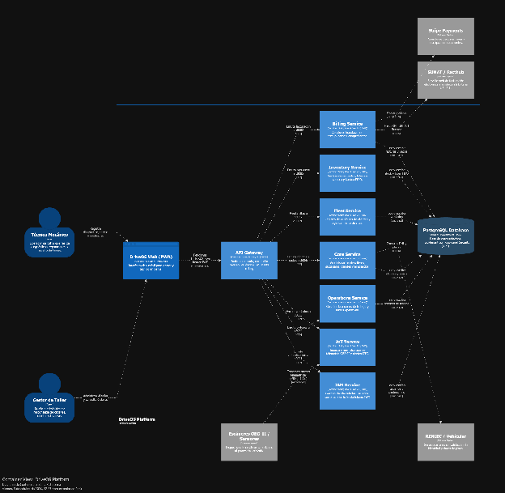

### ***4.1.4.4. Diagrama de Contenedores C4*** {#4.1.4.4.-diagrama-de-contenedores-c4}

La arquitectura de DriveOS Platform se descompone en diez (10) contenedores autónomos que delimitan las capacidades funcionales del negocio y garantizan escalabilidad independiente, diseñados bajo el estándar C4 Model (Nivel 2\) mediante Structurizr: 

**1\. DriveOS Web (PWA):** Aplicación web y móvil desarrollada en Angular 21 y TypeScript, orientada a dos perfiles diferenciados: panel gerencial para el gestor y vista simplificada de alto contraste para el técnico mecánico en bahía.

**2\. API Gateway:** Punto único de entrada perimetral implementado en Spring Boot / Go (puerto :8080), responsable del enrutamiento reverso, validación centralizada de tokens JWT y control de cuotas (Rate Limiting).

**3\. IAM Service:** Microservicio de gestión de identidades, autenticación y sesiones de usuario (puerto :8081), emisor de tokens JWT con roles RBAC.

**4\. Billing Service:** Microservicio responsable de la liquidación económica de órdenes, cálculo de presupuestos y generación de comprobantes fiscales (puerto :8082).

**5\. IoT Service:** Microservicio de ingesta telemática y normalización de lecturas OBD-II, encargado de capturar flujos de sensores (PIDs) y códigos de falla (puerto :8083).

**6\. Operations Service**: Núcleo transaccional operativo que gestiona el agregado de órdenes de trabajo, seguimiento de estados y asignación de tareas a mecánicos (puerto :8084).

**7\. Inventory Service:** Microservicio que administra el catálogo de repuestos, registro de lotes de compra y valoración contable bajo el método FIFO (puerto :8085).

**8\. Core Service:** Microservicio de administración de talleres, sucursales físicas, clientes y colaboradores (puerto :8086).

**9\. Fleet Service:** Microservicio especializado en el registro de flotas vehiculares y agendamiento de citas de mantenimiento (puerto :8087).

**10\. PostgreSQL Database:** Motor de base de datos relacional PostgreSQL 16 (puerto :5432) con Row-Level Security (RLS) para garantizar el aislamiento estricto de datos entre talleres clientes.

## Relaciones

- Padre: [[capitulo-iv/4.1.4.approach-driven-viewpoints-diagrams|4.1.4. Approach Driven ViewPoints Diagrams]]
- Índice: [[preliminares/contenido|CONTENIDO]]
