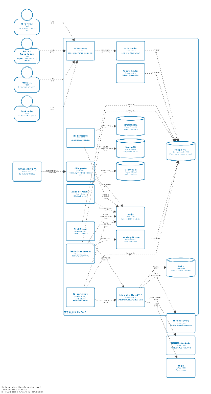
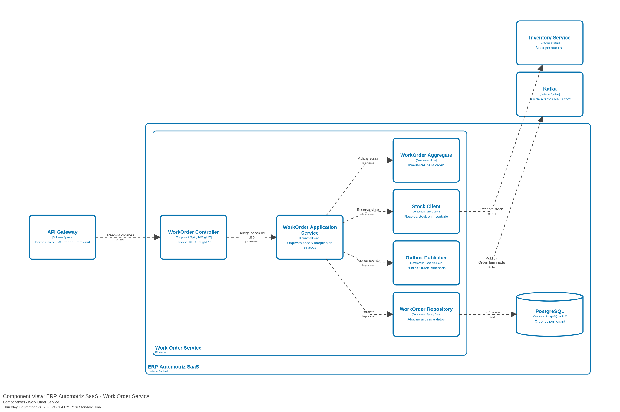

#### ***4.1.4.4. Diagrama de Contenedores*** {#4.1.4.4.-diagrama-de-contenedores}

El ERP se organiza en un borde único (Puerta de Enlace, API Gateway) que valida identidad (JWT y JWKS), propaga el tenant\_id y limita por plan, además de unidades por capacidad: identidad, talleres, flota, órdenes, inventario, ingesta y procesador IoT, facturación con lógica propia a través de Nubefact, hub de integraciones y analítica. Cada unidad es dueña de su persistencia: PostgreSQL transaccional con RLS, TimescaleDB para series, MongoDB para diagnósticos, ClickHouse para analítica, Redis para caché y rate-limit, y Kafka como bus de eventos mediante Outbox. Los sensores publican por MQTT o HTTPS al borde de ingesta; el resto de actores entra por HTTPS al gateway.

**Diagrama de contenedores**

  
4.1.4.5. Diagrama de Componentes

El controlador expone REST y gRPC, y delega en el servicio de aplicación, que orquesta la máquina de estados (recepción, diagnóstico, ejecución y entrega) sobre el agregado OrdenDeTrabajo. La persistencia queda detrás del repositorio hacia PostgreSQL; la reserva de stock sale por el cliente gRPC hacia Inventory; y el cambio relevante sale por el publicador Outbox hacia Kafka como OrdenTerminada, sin bloquear la respuesta al taller.

Diagrama de componentes

