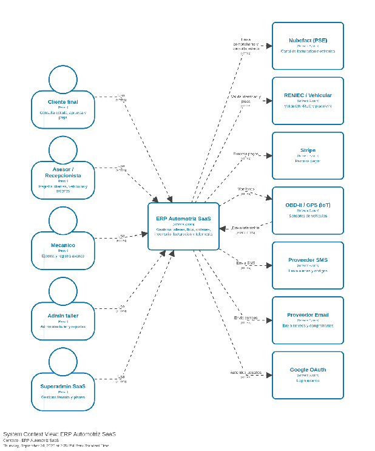

### ***4.1.4.6. Estandarización de Herramientas de Modelado*** {#4.1.4.6.-estandarización-de-herramientas-de-modelado}

Los diagramas C4 del sistema fueron elaborados mediante Structurizr DSL para mantener arquitectura basada en código. Las vistas complementarias UML (actividad, estados y clases) se diseñaron bajo la notación estándar OMG UML 2.5 utilizando LucidChart y PlantUML, cumpliendo las herramientas del curso.

**Diagrama de Contexto**  

## Relaciones

- Padre: [[capitulo-iv/4.1.4.approach-driven-viewpoints-diagrams-2|4.1.4. Approach driven ViewPoints Diagrams]]
- Índice: [[preliminares/contenido|CONTENIDO]]
