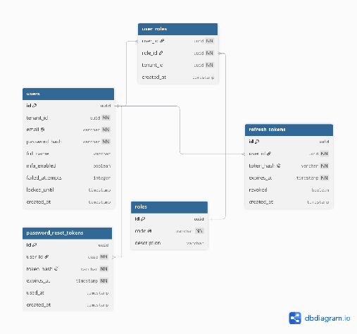
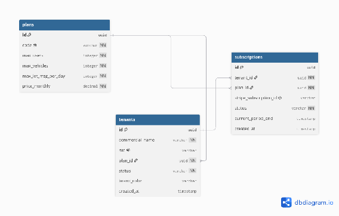
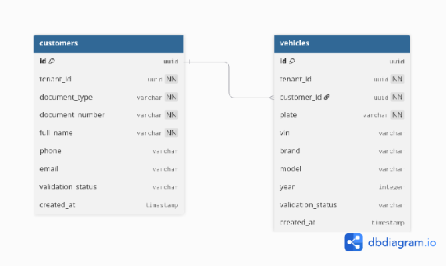
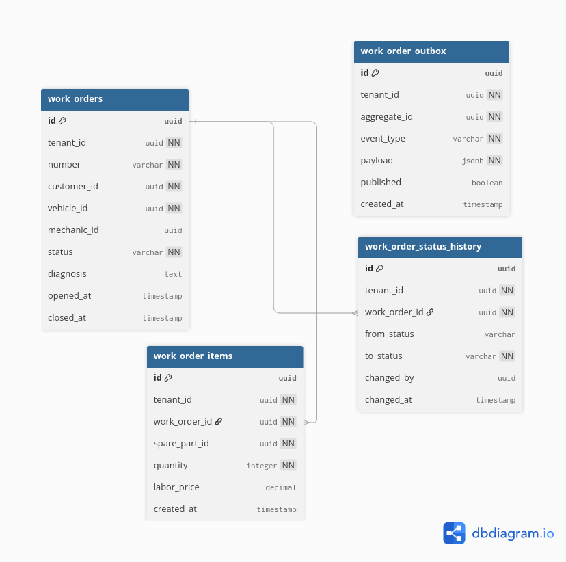
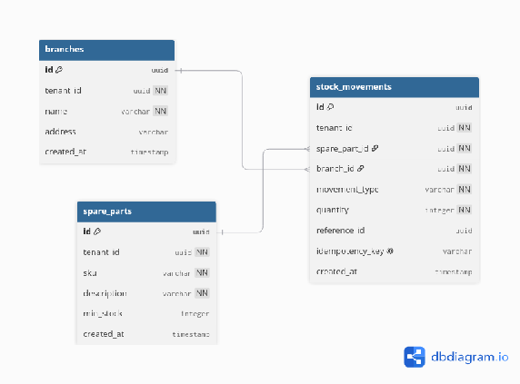
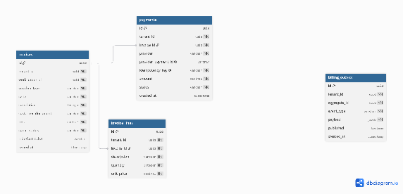
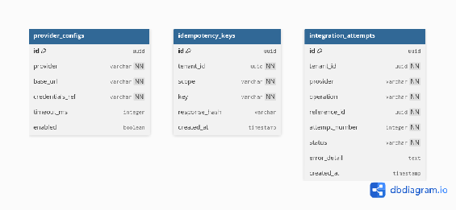
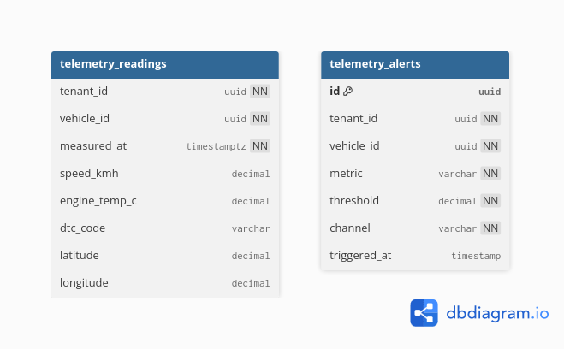

### ***4.1.5. Relational/Non Relational Database Diagram*** {#4.1.5.-relational/non-relational-database-diagram}

El almacenamiento de datos de DriveOS Workshop sigue un enfoque de persistencia políglota descentralizada, donde cada servicio gestiona su propia base de datos. Los modelos fueron elaborados y normalizados mediante LucidChart y Vertabelo, definiendo llaves primarias basadas en UUID v4, restricciones de integridad referencial, índices para consultas frecuentes y políticas de Row-Level Security (RLS) en PostgreSQL para aislar los datos entre talleres clientes.

A continuación se describe la estructura técnica de cada una de las bases de datos del sistema:

* **Auth Service (IAM Context \- PostgreSQL 16 con RLS)** El modelo de persistencia del servicio de autenticación e identidad centraliza la gestión de credenciales y sesiones seguras en PostgreSQL 16\. La tabla 'users' almacena la cuenta del usuario vinculada obligatoriamente a su taller mediante 'tenant\_id', protegiendo los accesos mediante políticas de Row-Level Security (RLS) que aíslan las consultas por inquilino. La asignación de permisos se estructura a través de la tabla asociativa 'user\_roles', que vincula usuarios con el catálogo de 'roles' del sistema (ROLE\_GESTOR\_TALLER, ROLE\_TECNICO\_MECANICO, etc.). Para asegurar la validez de las sesiones sin estado y mitigar riesgos de secuestro de credenciales, la tabla 'refresh\_tokens' administra los tokens de actualización con rotación automática y fecha de expiración, mientras que 'password\_reset\_tokens' gestiona las solicitudes temporales de restablecimiento de contraseña. El diagrama correspondiente a este esquema se presenta a continuación:

  

* **Tenant Service (Workshop Management Context \- PostgreSQL 16\)** Este esquema gobierna la estructura corporativa y comercial de los talleres suscritos a DriveOS. La tabla principal 'tenants' almacena la razón social, número de RUC (con restricción de unicidad), color corporativo y estado operativo del taller. Se relaciona mediante llave foránea con la tabla 'plans', que tipifica los niveles de suscripción (BÁSICO, PRO y ENTERPRISE) fijando las cuotas máximas de usuarios, vehículos y mensajes telemétricos diarios. Los cobros recurrentes y el ciclo de facturación mensual se registran en 'subscriptions', enlazando la cuenta del taller con la pasarela de pagos. Por su parte, la tabla 'branches' modela cada una de las sucursales o locales físicos, definiendo su dirección y los parámetros de geocerca perimetral (latitud, longitud y radio en metros) utilizados para la verificación de proximidad en el marcado de mano de obra. El diagrama correspondiente se presenta a continuación:

  

* **Fleet Service (Fleet & Customer Context \- PostgreSQL 16 con RLS)** El contexto de gestión de flota y clientes modela los activos vehiculares y sus propietarios dentro de cada taller en PostgreSQL 16\. La tabla 'customers' registra los datos personales del cliente (tipo y número de documento, nombre completo, teléfono y correo electrónico), incorporando un campo de estado de validación con fuentes externas. La tabla 'vehicles' almacena las características físicas del automóvil (placa de rodaje, código VIN de 17 caracteres, marca, modelo y año de fabricación), vinculándose al cliente propietario mediante 'customer\_id'. Para garantizar la consistencia de los datos en talleres con múltiples bahías, se define un índice único compuesto sobre '(tenant\_id, plate)', impidiendo registros duplicados de un mismo automóvil dentro del taller, con políticas RLS activas en ambas tablas. El diagrama correspondiente se presenta a continuación:

  

  

* **Work Order Service (Work Order Context \- PostgreSQL 16 con RLS)** Constituye el núcleo operativo de DriveOS Workshop, estructurando el ciclo de vida completo de cada servicio mecánico. La tabla principal 'work\_orders' actúa como la entidad raíz de la reparación, vinculando al cliente, vehículo y mecánico asignado, registrando los sellos de tiempo de apertura y cierre junto con el diagnóstico inicial. Los trabajos concretos y repuestos utilizados se desglosan en la tabla 'work\_order\_items', detallando cantidades, precios unitarios y tarifas de mano de obra. La trazabilidad operativa se asegura mediante 'work\_order\_status\_history', que guarda un registro inmutable de cada cambio de estado (RECEPCIONADA, EN\_DIAGNOSTICO, COTIZADA, EN\_EJECUCION, LISTA, ENTREGADA) con usuario responsable y fecha exacta. Asimismo, para evitar el problema de doble escritura distribuida y garantizar la publicación atómica de eventos hacia Apache Kafka, se incorpora la tabla 'work\_order\_outbox', monitoreada por el relevador CDC (Debezium). El diagrama correspondiente se presenta a continuación:

  

  

  

  

  

* **Inventory Service (Inventory & Kardex Context \- PostgreSQL 16 con RLS)** El esquema de persistencia de inventario garantiza el control estricto de existencias y la valorización contable automatizada bajo el principio FIFO (First-In, First-Out). El maestro de artículos se centraliza en 'spare\_parts', registrando código SKU, descripción y nivel de stock mínimo. El corazón del costeo reside en 'kardex\_lots', donde cada compra ingresada se registra como un lote independiente con su fecha de compra, costo unitario de adquisición, cantidad inicial, saldo actual y un campo 'version' para implementar control de concurrencia optimista (@Version en JPA), evitando sobreventas en bahía. Cada salida, reserva o devolución se audita en 'stock\_movements' mediante llaves de idempotencia únicas ('idempotency\_key'), vinculando el consumo directamente a la orden de trabajo atendida y al lote más antiguo con existencias disponibles. El diagrama correspondiente se presenta a continuación:

  

* **Billing Service (Billing & Fiscal Context \- PostgreSQL 16 con RLS)** Este modelo administra la emisión de comprobantes de pago electrónicos y la conciliación financiera con la normativa tributaria peruana (SUNAT). La tabla 'invoices' registra facturas, boletas y notas de crédito generadas a partir de órdenes de trabajo liquidadas, manteniendo una restricción de unicidad sobre '(tenant\_id, series, correlative)' para preservar la correlatividad legal inquebrantable, junto con el estado del comprobante (BORRADOR, PENDIENTE\_SUNAT, ACEPTADO, OBSERVADO) y el ticket fiscal devuelto por el PSE. Las líneas de detalle del comprobante se persisten en 'invoice\_lines' con el desglose de IGV y valor de venta. Los cobros procesados por tarjeta o billeteras digitales se gestionan en 'payments' con soporte para claves de idempotencia, mientras que 'billing\_outbox' garantiza la emisión asíncrona de eventos hacia el bus del sistema. El diagrama correspondiente se presenta a continuación:

  

  

* **Integration Hub Service (Anti-Corruption Layer Context \- PostgreSQL 16 & Redis 7\)** El esquema del Integration Hub gestiona la intermediación y desacoplamiento frente a plataformas externas (SUNAT, RENIEC, Stripe). En PostgreSQL 16, la tabla 'provider\_configs' almacena las credenciales cifradas, URLs base y tiempos límite (timeouts) de cada proveedor externo. La tabla 'idempotency\_keys' guarda temporalmente las firmas y respuestas de peticiones entrantes para interceptar reintentos de red y devolver respuestas cacheadas sin duplicar transacciones. La tabla 'integration\_attempts' audita cada reintento de comunicación con su código de estado, número de intento y detalle de error. De forma complementaria, el servicio utiliza una base de datos en memoria Redis 7 que actúa como caché lateral (Cache-Aside) con tiempo de vida (TTL) para almacenar validaciones de RUC (30 días) y placas vehiculares (7 días), absorbiendo consultas repetitivas sin consumir cuotas de APIs de pago. El diagrama correspondiente se presenta a continuación:

  

* **IoT & Telemetry Database (Telemetry & Analytics Context \- TimescaleDB & MongoDB 7\)** La persistencia de telemetría adopta un diseño políglota para resolver dos naturalezas de datos opuestas: series de tiempo de alta frecuencia y diagnósticos no estructurados multimarca. Para el flujo continuo de sensores telemétricos (RPM, velocidad, temperatura del motor, voltaje y coordenadas GPS) se utiliza la hipertabla 'telemetry\_readings' en TimescaleDB, particionada por rangos temporales de un día, garantizando tasas de inserción masiva sostenidas superiores a 5,000 registros por segundo. Las anomalías y códigos de falla confirmados se persisten en 'telemetry\_alerts'. Por otro lado, para almacenar las tramas de diagnóstico crudas y variables emitidas por diferentes marcas y modelos de escáneres OBD-II, se emplea una base de datos documental MongoDB 7 en la colección 'diagnostic\_sessions', permitiendo almacenar payloads JSON flexibles sin forzar esquemas relacionales rígidos. Los diagramas respectivos se presentan a continuación:

