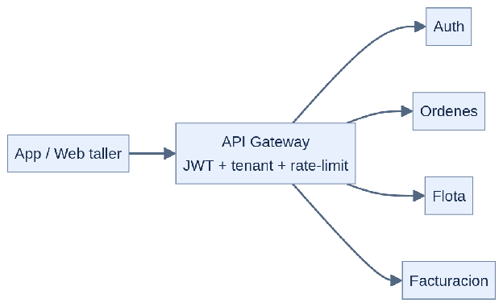

#### ***4.1.6.1. Patrón Gateway: ApiGateway, JwtValidator y PlanRateLimiter*** {#4.1.6.1.-patrón-gateway:-apigateway,-jwtvalidator-y-planratelimiter}

El patrón Gateway concentra en un borde único el enrutamiento, la autenticación y la protección de los servicios internos, para que ningún cliente hable directo con ellos. En nuestro ERP se aplicará mediante erp-api-gateway (Go) con JwtValidator (valida JWT contra JWKS del auth-service con caché de 5 minutos), TenantPropagator (inyecta el tenant\_id en metadata gRPC y trazas) y PlanRateLimiter (topes por plan leídos del tenant-service con contadores en Redis). De esta forma, la app del mecánico, la web del asesor y el portal del cliente usan un solo contrato de borde, y la lógica de seguridad y cuotas no se repite en cada servicio. Este patrón sostiene Seguridad (QA-4/QA-5) y Disponibilidad (QA-3), y permite cambiar autenticación o planes sin tocar el núcleo.

####
