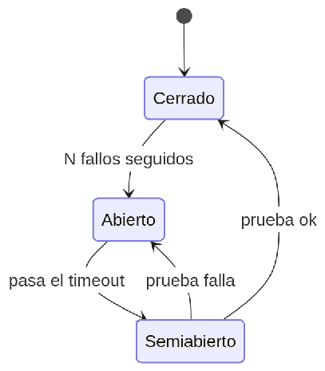

#### ***4.1.6.10. Patrón Interruptor de Circuito: StockCircuitBreaker y HubCircuitBreakers*** {#4.1.6.10.-patrón-interruptor-de-circuito:-stockcircuitbreaker-y-hubcircuitbreakers}

El patrón Interruptor de Circuito (Circuit Breaker) deja de llamar a un servicio caído durante un tiempo (circuito abierto) tras N fallos, prueba con una llamada (semiabierto) y se cierra al recuperarse, con una respuesta degradada mientras tanto. En nuestro ERP se aplicará con StockCircuitBreaker (Resilience4j) en la llamada gRPC ReserveStock de órdenes a inventario, y un breaker por adaptador en el hub (NubefactBreaker, ReniecBreaker, StripeBreaker): si RENIEC se pone lento, fleet responde con caché o marca validation=pending en vez de colgar la recepción. Protege Disponibilidad (QA-3) y evita que un caído arrastre al resto en cascada.

## Relaciones

- Padre: [[capitulo-iv/4.1.6.design-patterns|4.1.6. Design Patterns]]
- Índice: [[preliminares/contenido|CONTENIDO]]
