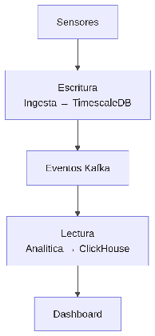

#### ***4.1.6.11. Patrón CQRS: IotIngestionWriter y AnalyticsReader*** {#4.1.6.11.-patrón-cqrs:-iotingestionwriter-y-analyticsreader}

El patrón CQRS (segregación comando/consulta) separa el camino de escritura del de lectura, cada uno con su modelo y almacén optimizado. En nuestro ERP se aplicará donde el volumen lo exige: IotIngestionWriter recibe miles de lecturas por segundo y las guarda en TimescaleDB, mientras AnalyticsReader sirve dashboards y KPIs desde ClickHouse alimentado por eventos, con retardo documentado de 1–5 minutos. El núcleo transaccional (órdenes/inventario) mantendrá modelo unificado hasta que un escenario pruebe lo contrario. Así el pico de sensores nunca degrada la operación de oficina (QA-1/QA-2).

## Relaciones

- Padre: [[capitulo-iv/4.1.6.design-patterns|4.1.6. Design Patterns]]
- Índice: [[preliminares/contenido|CONTENIDO]]
