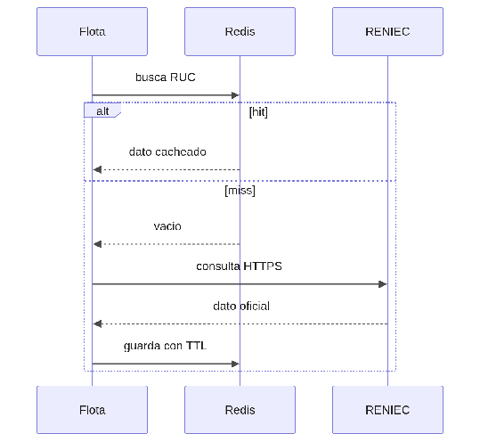

#### ***4.1.6.12. Patrón Caché lateral: RucCache y PlacaCache*** {#4.1.6.12.-patrón-caché-lateral:-ruccache-y-placacache}

El patrón Caché lateral (Cache-Aside) consulta primero un guardado temporal con tiempo de vida y solo golpea al proveedor si falta, guardando luego la respuesta. En nuestro ERP se aplicará con RucCache (TTL \~30 días) y PlacaCache (TTL \~7 días) en Redis dentro del hub, usados por flota al registrar clientes y vehículos. Así, validar dos veces el mismo RUC solo llama a RENIEC la primera: responde más rápido (QA-2) y la recepción sigue funcionando con datos cacheados si el proveedor cae (QA-6).

## Relaciones

- Padre: [[capitulo-iv/4.1.6.design-patterns|4.1.6. Design Patterns]]
- Índice: [[preliminares/contenido|CONTENIDO]]
