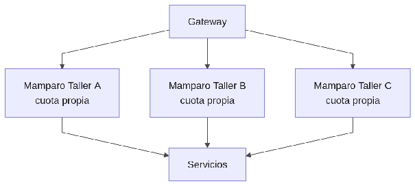

#### ***4.1.6.13. Patrón Mamparo: TenantBulkheads y pools por servicio*** {#4.1.6.13.-patrón-mamparo:-tenantbulkheads-y-pools-por-servicio}

El patrón Mamparo (Bulkhead) compartimenta recursos para que un consumidor glotón no hunda a los demás, como los mamparos de un barco. En nuestro ERP se aplicará con TenantBulkheads en el gateway (cuota de hilos/conexiones por taller según su plan) y pools de conexiones separados por servicio hacia PostgreSQL/Kafka, más grupos de consumidores independientes para IoT vs negocio. Así, la ráfaga de telemetría de un taller grande consume su cuota sin degradar el p95 de los demás, protegiendo Disponibilidad y aislamiento por tenant (QA-3/QA-4).

