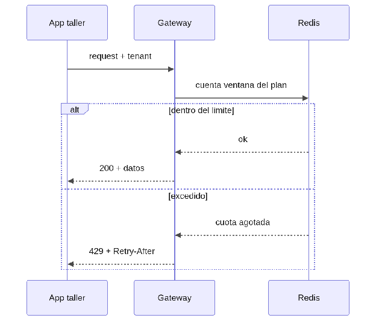

#### ***4.1.6.14. Patrón Límite de peticiones: PlanRateLimiter con Redis*** {#4.1.6.14.-patrón-límite-de-peticiones:-planratelimiter-con-redis}

El patrón Límite de peticiones (Rate Limiting) pone un tope por ventana temporal según el plan del taller y responde 429 con Retry-After al excederlo. En nuestro ERP se aplicará con PlanRateLimiter en el gateway, que lee los límites del tenant-service y cuenta en Redis por tenant\_id y endpoint. Así se hacen cumplir los planes BASICO/PRO, se frenan abusos y picos accidentales (QA-2/QA-5), y el cliente sabe exactamente cuándo reintentar por la cabecera de respuesta.

## Relaciones

- Padre: [[capitulo-iv/4.1.6.design-patterns|4.1.6. Design Patterns]]
- Índice: [[preliminares/contenido|CONTENIDO]]
