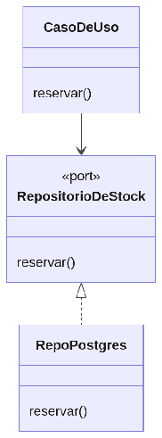

#### ***4.1.6.2. Patrón Repository: RepositorioDeOrdenes, RepositorioDeStock y RepositorioDeComprobantes*** {#4.1.6.2.-patrón-repository:-repositoriodeordenes,-repositoriodestock-y-repositoriodecomprobantes}

El patrón Repository esconde el acceso a datos tras una interfaz del dominio: el caso de uso pide y guarda sin saber si detrás hay PostgreSQL, qué esquema usa ni cómo se aplica el filtro por taller. En nuestro ERP se aplicará con RepositorioDeOrdenes (implementado por PgRepositorioDeOrdenes), RepositorioDeStock (con reservar/liberar idempotentes), RepositorioDeComprobantes y RepositorioDeUsuarios (que además encapsulará la rotación de refresh tokens y el bloqueo por intentos). Así, si mañana se particiona una tabla, se agrega RLS o se cambia de motor, solo cambia el adaptador Postgres y las reglas de órdenes, stock y facturación quedan intactas. Mejora Modificabilidad y Testeabilidad: los casos de uso se prueban en memoria sin base de datos.

