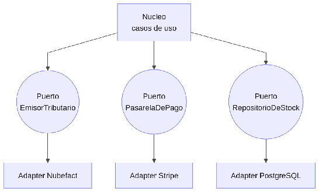

#### ***4.1.6.3. Patrón Puertos y Adaptadores: EmisorTributario, PasarelaDePago y ValidadorIdentidad*** {#4.1.6.3.-patrón-puertos-y-adaptadores:-emisortributario,-pasareladepago-y-validadoridentidad}

El patrón Puertos y Adaptadores (arquitectura hexagonal) invierte las dependencias: el núcleo define puertos con lo que necesita y los detalles (base de datos, proveedor externo) se conectan como adaptadores inyectados. En nuestro ERP el núcleo de facturación dependerá de EmisorTributario (implementado por NubefactAdapter), de PasarelaDePago (implementado por StripeAdapter) y de ValidadorIdentidad (implementado por ReniecAdapter); el núcleo operativo dependerá de RepositorioDeStock y la telemetría de LectorOBD. De esta forma, cambiar de Nubefact a otro PSE o de Stripe a otra pasarela solo exige un adaptador nuevo, sin reescribir facturación. Protege Modificabilidad (QA-7) y permite probar el núcleo sin red ni base de datos.

