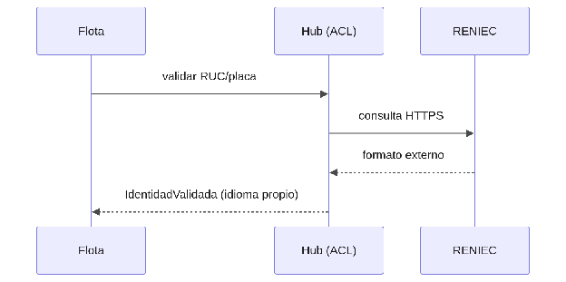

#### ***4.1.6.4. Patrón Adapter y Capa Anticorrupción: NubefactAdapter, StripeAdapter y ReniecAdapter*** {#4.1.6.4.-patrón-adapter-y-capa-anticorrupción:-nubefactadapter,-stripeadapter-y-reniecadapter}

El patrón Adapter permite que componentes con interfaces distintas colaboren mediante una capa intermedia que traduce la integración externa al modelo interno. En nuestro ERP se aplicará principalmente en el hub de integraciones, que además actúa como Capa Anticorrupción: NubefactAdapter adapta el envío/consulta de comprobantes al contrato interno ComprobanteParaDeclarar (con estados propios PENDIENTE\_SUNAT/ACEPTADO/OBSERVADO); StripeAdapter adapta los cobros al contrato CobroConIdempotencia (con idempotency-key obligatorio); ReniecAdapter adapta la validación de RUC/placa a IdentidadValidada; y GoogleOAuthClient con GoogleTokenVerifier adaptan el login federado a nuestra sesión interna (tenant\_id \+ roles). Los webhooks entrantes se verificarán con HmacVerifier. Así, la lógica del taller nunca depende directo de la API de un proveedor: se puede reemplazar una integración sin afectar el negocio, mejorando mantenibilidad y reduciendo acoplamiento.

