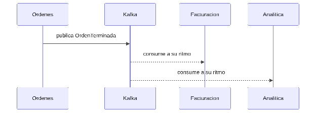

#### ***4.1.6.5. Patrón Observer con eventos de dominio: OrdenTerminada, FacturaEmitida y AnomaliaDetectada*** {#4.1.6.5.-patrón-observer-con-eventos-de-dominio:-ordenterminada,-facturaemitida-y-anomaliadetectada}

El patrón Observer, distribuido vía Kafka, permite que un productor publique un hecho y N consumidores reaccionen sin conocerse entre sí. En nuestro ERP WorkOrderService publicará OrdenTerminada, BillingService publicará FacturaEmitida, TenantService publicará TenantProvisioned e IotProcessor publicará AnomaliaDetectada; consumirán BillingService, AnalyticsService, el notificador y el propio WorkOrderService según el tópico, cada uno a su ritmo y con su grupo de consumidores. De esta forma, si analítica o notificaciones están caídas, el taller sigue operando y los eventos esperan en el bus. Sostiene Desempeño ante picos IoT (QA-1) y desacopla en tiempo a todo el sistema (P4).

