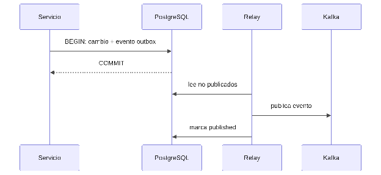

#### ***4.1.6.6. Patrón Outbox: WorkOrderOutboxRelay, BillingOutboxRelay y TenantOutboxRelay*** {#4.1.6.6.-patrón-outbox:-workorderoutboxrelay,-billingoutboxrelay-y-tenantoutboxrelay}

El patrón Bandeja de Salida Transaccional (Transactional Outbox) guarda el cambio de negocio y el evento en la misma transacción local de PostgreSQL, y un relevador los publica después al bus, garantizando entrega "al menos una vez" sin transacciones distribuidas. En nuestro ERP se aplicará con las tablas work\_order\_outbox (eventos OrdenTerminada/OrdenCancelada), billing\_outbox (FacturaEmitida) y la de tenants (TenantProvisioned), publicadas por WorkOrderOutboxRelay, BillingOutboxRelay y TenantOutboxRelay con marca published. Así, emitir un comprobante y avisar al resto del sistema son atómicos aunque Kafka esté caído en ese instante, cumpliendo RPO=0 en datos críticos (QA-3).

## Relaciones

- Padre: [[capitulo-iv/4.1.6.design-patterns|4.1.6. Design Patterns]]
- Índice: [[preliminares/contenido|CONTENIDO]]
