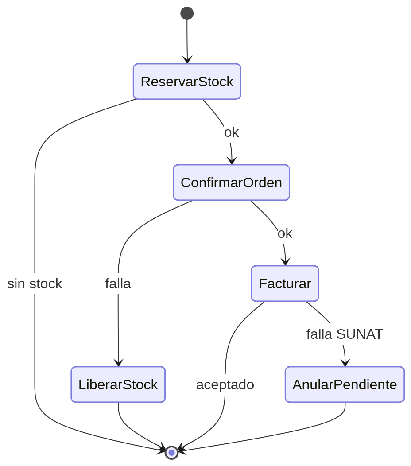

#### ***4.1.6.7. Patrón Saga coreografiada: ReservaStock/LiberaStock y EmisionPendiente/Anulacion*** {#4.1.6.7.-patrón-saga-coreografiada:-reservastock/liberastock-y-emisionpendiente/anulacion}

El patrón Saga coordina un proceso largo en pasos locales por servicio, cada uno con su compensación si algo falla, sin transacción distribuida que bloquee. En nuestro ERP el flujo será: WorkOrderService pide ReservarStock a inventario; si confirma, avanza la orden; si el pago o la emisión fallan, ejecuta LiberarStock; si SUNAT observa el comprobante, se ejecuta AnularPendiente y se reemite. Ningún paso cruza dos bases de datos sincrónicamente y cada evento viaja por outbox. Así se evita la falla en cascada que provocaría una confirmación en dos fases, protegiendo Disponibilidad (QA-3) a costa de programar compensaciones explícitas y testeadas.

## Relaciones

- Padre: [[capitulo-iv/4.1.6.design-patterns|4.1.6. Design Patterns]]
- Índice: [[preliminares/contenido|CONTENIDO]]
