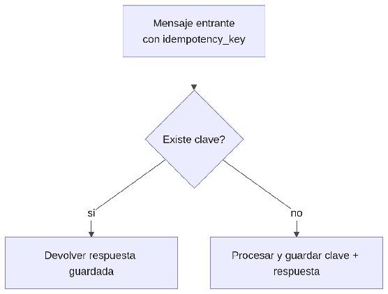

#### ***4.1.6.8. Patrón Receptor idempotente: IdempotencyFilter e idempotency\_keys*** {#4.1.6.8.-patrón-receptor-idempotente:-idempotencyfilter-e-idempotency_keys}

El patrón Receptor idempotente hace que reprocesar el mismo mensaje no duplique el efecto, usando una clave de idempotencia única por operación. En nuestro ERP se aplicará con IdempotencyFilter en consumidores Kafka y endpoints de reserva/cobro, apoyado en la tabla idempotency\_keys del hub (por tenant\_id \+ alcance \+ clave, con respuesta guardada) y en la columna idempotency\_key de stock\_movements y payments, más el header de idempotencia que exige Stripe. Así, un mensaje duplicado del outbox o un reintento de cobro devuelve la respuesta guardada sin reservar dos veces ni cobrar de más, haciendo seguro el "al menos una vez".

## Relaciones

- Padre: [[capitulo-iv/4.1.6.design-patterns|4.1.6. Design Patterns]]
- Índice: [[preliminares/contenido|CONTENIDO]]
