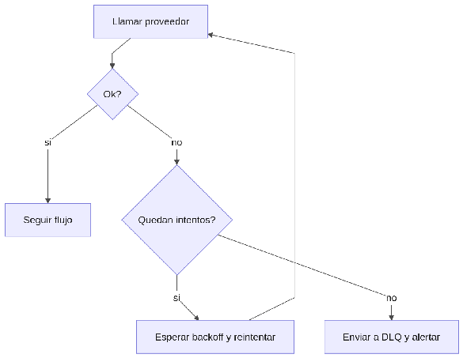

#### ***4.1.6.9. Patrón Reintento con espera y DLQ: RetryPolicy e integration\_attempts*** {#4.1.6.9.-patrón-reintento-con-espera-y-dlq:-retrypolicy-e-integration_attempts}

El patrón combina reintentos con espera creciente (backoff) ante fallos transitorios y una Cola de Muertos (Dead Letter Queue, DLQ) para lo que agota intentos y requiere revisión. En nuestro ERP se aplicará con RetryPolicy exponencial en el hub (hasta \~24h para Nubefact/Stripe/RENIEC, registrado en integration\_attempts con estados OK/RETRY/DLQ) y DLQ de Kafka para telemetría malformada. Mientras tanto el negocio sigue en modo offline-first (comprobante PENDIENTE\_SUNAT, validación pending). Así se toleran caídas de 30 minutos de proveedores sin perder datos (QA-6) y lo envenenado queda aislado con alerta en vez de bloquear el flujo.  

## Relaciones

- Padre: [[capitulo-iv/4.1.6.design-patterns|4.1.6. Design Patterns]]
- Índice: [[preliminares/contenido|CONTENIDO]]
