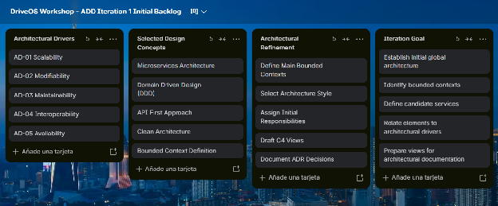

### **4.3.1.1 Architectural Design Backlog 1**

El Architectural Design Backlog define las principales decisiones arquitectónicas que serán consideradas durante esta iteración. Debido a que DriveOS Workshop es una plataforma SaaS B2B orientada a talleres automotrices, la arquitectura debe permitir crecimiento progresivo, independencia entre capacidades del negocio e integración con servicios externos.

**Historias de Usuario Primarias:** US01 (Registro y configuración de taller automotriz), US07 (Creación y asignación de órdenes de trabajo) y US14 (Gestión de stock de repuestos e insumos).

**Escenarios de Atributos de Calidad:** QA-10 (Modificabilidad e Independencia de Despliegue: Un cambio en el modelo de inventario o facturación debe desplegarse en producción sin reiniciar los servicios restantes, logrando un ciclo de despliegue \< 15 minutos sin downtime global) y QA-11 (Mantenibilidad y Testabilidad: La cobertura de pruebas unitarias sobre la lógica de negocio core debe alcanzar \>= 80% mediante aislamiento estricto de dependencias de infraestructura).

**Restricciones Arquitecturales:** CON-1 (Arquitectura Cloud-Native distribuida basada en contenedores y ejecución en clúster Kubernetes) y CON-2 (Uso de interfaces de comunicación estándar REST/JSON y mensajería orientada a eventos).

**Preocupaciones Arquitecturales:** CRN-1 (Garantizar la modularidad y separación de responsabilidades para permitir el desarrollo concurrente por múltiples sub-equipos de ingeniería sin bloqueos de código).

