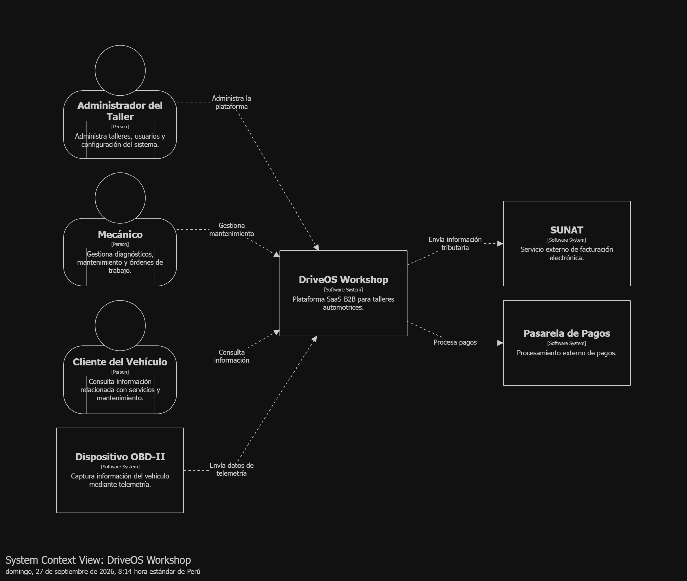
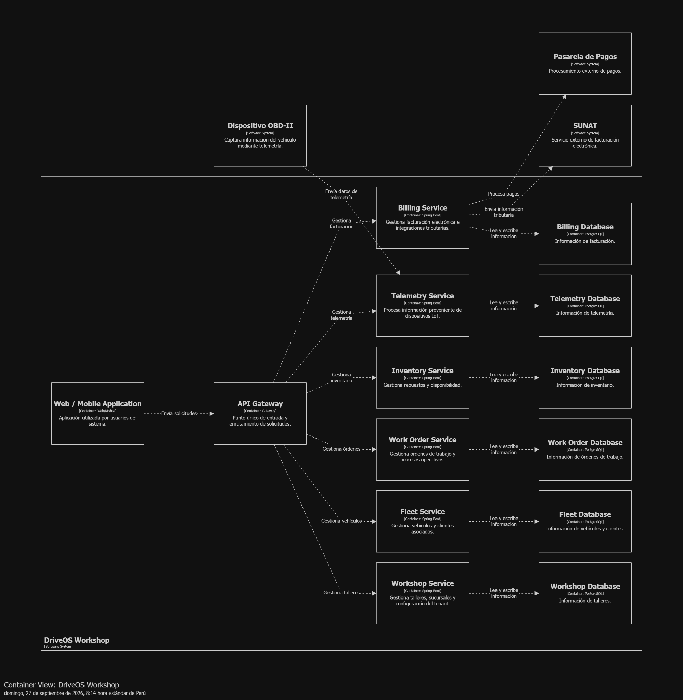
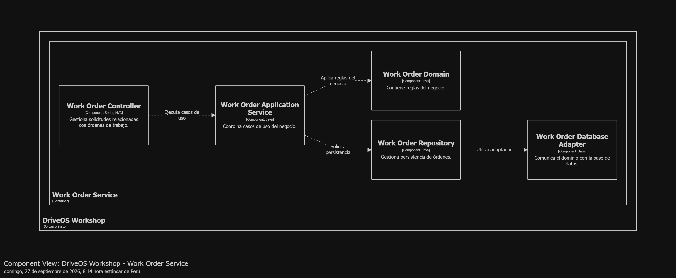
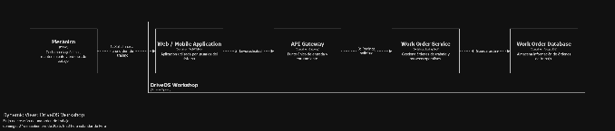

### **4.3.1.6 Sketch Views (C4 & UML) and Record Design Decisions**

Se formalizaron los primeros dos Registros de Decisiones Arquitecturales (ADR) con su respectiva trazabilidad:

**ADR-001: Registro de Decisión Arquitectural 001**

**Título:** Adopción de Microservicios Desacoplados por Bounded Context.

**Estado:** Aprobado.

**Drivers Arquitecturales:** Requerimiento de calidad QA-10 (Modificabilidad e Independencia de Despliegue), Restricción CON-1 (Cloud-Native en Kubernetes) y Preocupación CRN-1 (Modularidad y trabajo concurrente).

**Componente Afectado:** Arquitectura Global de DriveOS y Core Services (Auth, Tenant, Fleet, Work Order, Inventory, Billing).

**Decisión:** Descomponer la solución en un conjunto de microservicios autónomos delimitados por las fronteras de Bounded Contexts de DDD, adoptando el principio de Database-per-Service y comunicación mediante contratos explícitos RESTful/JSON y eventos de dominio.

**Consecuencias:** Permite el escalamiento vertical y horizontal selectivo, despliegues continuos sin interrupción global y aislamiento de fallos entre dominios de negocio. Introduce como trade-off una mayor complejidad operativa en la gestión de infraestructura distribuida, la cual se mitiga mediante Kubernetes y observabilidad unificada.

**ADR-002: Registro de Decisión Arquitectural 002**

**Título:** Implementación de Arquitectura Hexagonal (Ports & Adapters) en Microservicios.

**Estado:** Aprobado.

**Drivers Arquitecturales:** Requerimiento de calidad QA-11 (Mantenibilidad y Testabilidad \>= 80%) y QA-10 (Modificabilidad).

**Componente Afectado:** Capa Interna de Dominio, Aplicación e Infraestructura de todos los microservicios.

**Decisión:** Estructurar internamente cada microservicio bajo el patrón de Arquitectura Hexagonal, desacoplando estrictamente las entidades de dominio y casos de uso (núcleo) respecto a los adaptadores de entrada (controladores REST, listeners de mensajería) y adaptadores de salida (repositorios JPA/SQL, clientes HTTP externos, publicadores Kafka).

**Consecuencias:** Garantiza que la lógica de negocio sea 100% testeable de forma aislada mediante dobles de prueba (mocks/stubs) sin requerir bases de datos levantadas. Permite cambiar bases de datos o brokers sin alterar una sola línea de lógica de negocio.

Las decisiones arquitectónicas serán documentadas mediante Architecture Decision Records (ADR).

| ADR | Decisión |  | Alternativa descartada | Consecuencia |
| :---- | :---- | :---- | :---- | :---- |
| ADR-001 | Arquitectura basada en microservicios por dominio. |  | Arquitectura monolítica. | Mayor escalabilidad y autonomía con mayor complejidad operativa. |
| ADR-002 | Uso de Bounded Contexts para dividir responsabilidades. |  | Separación únicamente por capas técnicas. | Mayor alineación entre negocio y arquitectura. |

## Relaciones

- Padre: [[capitulo-iv/4.3.1-iteration-1-global-system-structure-domain-decomposition|4.3.1 Iteration 1: Global System Structure & Domain Decomposition]]
- Índice: [[preliminares/contenido|CONTENIDO]]
