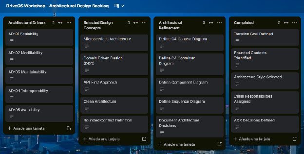

### **4.3.1.7 Analysis of Current Design and Review Iteration Goal (Kanban Board)** {#4.3.1.7-analysis-of-current-design-and-review-iteration-goal-(kanban-board)}

El equipo evaluó la arquitectura resultante de la Iteración 1 mediante una sesión técnica estructurada. Se confirmó que el objetivo de establecer la partición estructural y estilos base fue plenamente alcanzado. La siguiente tabla refleja el estado del backlog arquitectural en el tablero Kanban oficial de Trello 

| Not Addressed | Partially Addressed | Completely Addressed | Design decisions made during the iteration |
| ----- | ----- | ----- | ----- |
| • QA-01 (Latencia IoT) • QA-03 (Disponibilidad 99.9%) • QA-05 (Seguridad RLS) • QA-08 (Interoperabilidad SUNAT) | • CON-1 (Cloud Kubernetes) • CRN-1 (Modularidad de sub-equipos) | • QA-10 (Modificabilidad de microservicios) • QA-11 (Testabilidad con Arq. Hexagonal) | • ADR-001: Descomposición en Microservicios por DDD • ADR-002: Arquitectura Hexagonal en Core Services |

Link:[https\://trello.com/invite/b/6ab9084279849c0370ec5529/ATTI9d8fc69afbabffcdb55dde96d86fd6632F61CFD9/driveos-workshop-architectural-design-backlog](https://trello.com/invite/b/6ab9084279849c0370ec5529/ATTI9d8fc69afbabffcdb55dde96d86fd6632F61CFD9/driveos-workshop-architectural-design-backlog)

A continuación, se presenta la **Iteración 2** del método **Attribute-Driven Design (ADD)** estructurada minuciosamente bajo el mismo formato, rigor metodológico y profundidad técnica aplicados en la Iteración 1\.

Esta iteración aborda un tema arquitectónico crítico y diferenciado: **Arquitectura de Integración Asíncrona, Ingesta de Telemetría IoT en Tiempo Real y Resiliencia Distribuida**.

## Relaciones

- Padre: [[capitulo-iv/4.3.1-iteration-1-global-system-structure-domain-decomposition|4.3.1 Iteration 1: Global System Structure & Domain Decomposition]]
- Índice: [[preliminares/contenido|CONTENIDO]]
