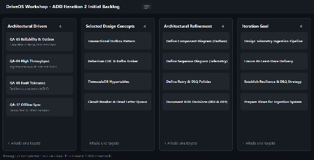

#### ***4.3.2.2 Establish Iteration Goal by Selecting Drivers*** {#4.3.2.2-establish-iteration-goal-by-selecting-drivers}

El objetivo principal de la Iteración 2 es diseñar la infraestructura de mensajería e integración asíncrona que soporte la ingesta continua de telemetría OBD-II, aislando el dominio de negocio principal y garantizando tolerancia a fallos mediante patrones de consistencia eventual.

A continuación, se presentan los controladores arquitectónicos priorizados que rigen este ciclo de diseño:

| ID Driver | Tipo | Descripción Corta | Criterio de Aceptación / Escenario de Calidad |
| ----- | ----- | ----- | ----- |
| QA-01 | Atributo de Calidad (Rendimiento) | Rendimiento y Throughput de Ingesta | Capacidad de recibir, procesar y almacenar ráfagas constantes de datos telemáticos desde dispositivos OBD-II con latencia de procesamiento \< 500 ms (p95). |
| QA-03 | Atributo de Calidad (Disponibilidad) | Alta Disponibilidad y Concurrencia | Absorber de manera continua hasta 1,500 eventos por segundo de telemetría vehicular sin degradación del sistema transaccional (99.9% uptime). |
| QA-09 | Atributo de Calidad (Resiliencia) | Tolerancia a Fallos y Recuperabilidad | Cero pérdida de eventos de telemetría ante caídas temporales de red o microservicios consumidores, garantizando un RTO \<= 5 minutos. |
| CON-4 | Restricción Arquitectural | Protocolos Ligeros y Streaming | Uso obligatorio de protocolos ligeros de comunicación telemática (MQTT/HTTP) y broker de streaming distribuido tipo log particionado. |

**Tablero Kanban de la Iteración 2 (ADD Iteration 2 Backlog)**  

## Relaciones

- Padre: [[capitulo-iv/4.3.2-iteration-2-asynchronous-integration-real-time-iot-ingestion-resilience-architecture|4.3.2 Iteration 2: Asynchronous Integration, Real-Time IoT Ingestion & Resilience Architecture]]
- Índice: [[preliminares/contenido|CONTENIDO]]
