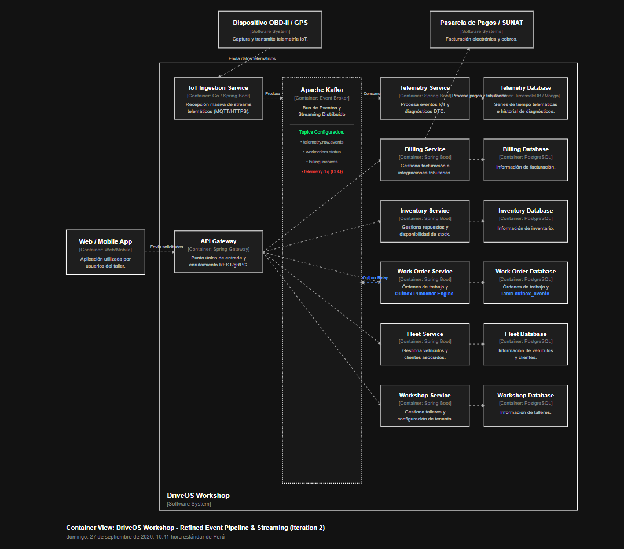
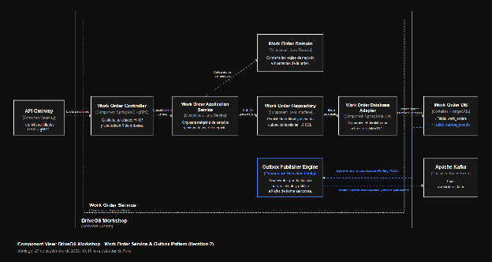
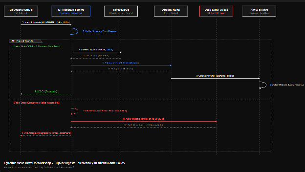

#### ***4.3.2.6 Sketch Views (C4 & UML) and Record Design Decisions*** {#4.3.2.6-sketch-views-(c4-&-uml)-and-record-design-decisions}

**1\. Vista de Contenedores Refinada: Pipeline de Eventos y Streaming (C4 Container View)**  
Representa la integración del Event Broker (*Apache Kafka*) como el núcleo de mensajería asíncrona entre el servicio de ingesta de dispositivos OBD-II, el microservicio de Telemetría y los emisores de eventos transaccionales vía *Outbox Pattern*.  

**2\. Vista de Componentes: Ingesta e Integración con Outbox Pattern (C4 Component View)**  
Ilustra la estructura interna del **Work Order Service** y su acoplamiento con la estrategia *Transactional Outbox* para la emisión garantizada de eventos de dominio hacia la plataforma de eventos sin usar transacciones distribuidas (2PC).  

**3\. Vista Dinámica: Flujo de Ingesta Telemática y Resiliencia ante Fallos (Sequence Diagram)**  
Describe el comportamiento dinámico desde la captura de telemetría OBD-II hasta la persistencia asíncrona, incorporando la gestión de reintentos y desvío a la cola de errores (*DLQ*) ante interrupciones de disponibilidad.  

**Registros de Decisión Arquitectónica (ADR) \- Iteración 2**

| ADR | Decisión Tomada | Drivers Relacionados | Componente Afectado | Alternativa Descartada | Consecuencia / Impacto |
| ----- | ----- | ----- | ----- | ----- | ----- |
| ADR-003 | Adopción de Apache Kafka como Event Broker y Streaming Platform para la ingesta de telemetría y bus de eventos interservicios. | QA-01, QA-03, QA-09 | IoT Ingestion & Telemetry Processor | Uso de REST/HTTP síncrono o RabbitMQ tradicional. | Soporta procesamiento masivo en tiempo real y re-procesamiento de streams con alta disponibilidad, añadiendo complejidad operacional de infraestructura. |
| ADR-004 | Patrón Transactional Outbox con CDC (Change Data Capture) para la publicación de eventos de dominio. | QA-03, QA-09 | Work Order & Billing Outbox Engines | Transacciones Distribuidas (Two-Phase Commit \- 2PC) o llamadas HTTP directas tras guardar en BD. | Elimina la posibilidad de perder eventos (Dual-Write Problem) y garantiza consistencia eventual entre microservicios sin bloqueos de base de datos. |
| ADR-005 | Estrategia de Resiliencia con Dead Letter Queue (DLQ) en Kafka en el consumo de eventos. | QA-09 | Telemetry Processor & Tópico DLQ | Reintentos infinitos síncronos o ignorar fallos de procesamiento. | Evita el envenenamiento de colas (Poison Pill) y protege la plataforma frente a caídas temporales de servicios downstream (cumpliendo RTO \<= 5 min). |
