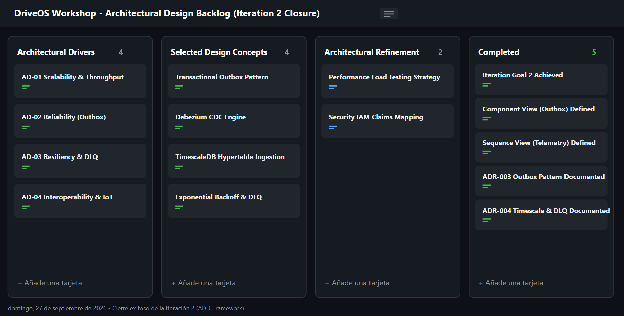

#### ***4.3.2.7 Analysis of Current Design and Review Iteration Goal (Kanban Board)*** {#4.3.2.7-analysis-of-current-design-and-review-iteration-goal-(kanban-board)}

Al finalizar la Iteración 2, se realiza la evaluación del diseño respecto a los objetivos planteados:

 **• Rendimiento e Ingesta de Telemetría:**  El aislamiento del IoT Ingestion Service acoplado directamente a Apache Kafka permite absorber picos de tráfico de escáneres OBD-II sin impactar las bases de datos transaccionales de órdenes de trabajo o inventarios.

 **• Consistencia Eventual y Tolerancia a Fallos:**  La adopción del patrón Transactional Outbox asegura la publicación confiable de eventos transaccionales, mientras que la inclusión de Dead Letter Queues (DLQ) responde al escenario de disponibilidad de tolerancia a cortes temporales (RTO \<= 5 min).

**• Alineación con Requerimientos:**  Se satisface la necesidad de desacoplamiento de servicios y escalabilidad en la ingesta telemática.

**Tablero Kanban Actualizado al Cierre de la Iteración 2**

Con la estructura global definida (Iteración 1\) y el motor de integración asíncrona telemática consolidado (Iteración 2), la **Iteración 3** abordará la **Seguridad, Aislamiento Multi-inquilino (Multi-Tenancy) y Control de Acceso basado en Roles (RBAC)** en la plataforma SaaS.

## Relaciones

- Padre: [[capitulo-iv/4.3.2-iteration-2-asynchronous-integration-real-time-iot-ingestion-resilience-architecture|4.3.2 Iteration 2: Asynchronous Integration, Real-Time IoT Ingestion & Resilience Architecture]]
- Índice: [[preliminares/contenido|CONTENIDO]]
