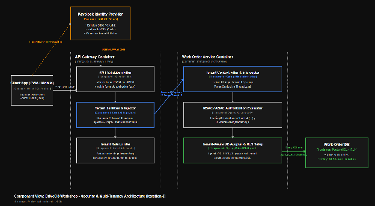
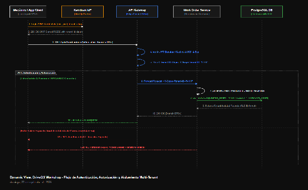

### **4.3.3.6 Sketch Views (C4 & UML) and Record Design Decisions** {#4.3.3.6-sketch-views-(c4-&-uml)-and-record-design-decisions}

**1\. Vista de Componentes (C4 Component View \- Security & Multi-Tenancy Architecture)**  
El siguiente diagrama detalla la arquitectura interna del API Gateway y los microservicios de negocio colaborando para validar la identidad, inyectar el contexto de inquilino y consultar la base de datos aislada por Row-Level Security:

**2\. Vista Dinámica: Diagrama de Secuencia (Dynamic View \- Security & Tenant Authorization Flow)**  
Este diagrama describe la secuencia interactiva completa de una petición protegida realizada por un mecánico, mostrando el ciclo de vida del token, la validación en borde y la evaluación de RLS en base de datos:

**Registros de Decisión Arquitectónica (ADR) \- Iteración 3**

#### 

| ADR | Decisión Tomada | Drivers Relacionados | Componente Afectado | Alternativa Descartada | Consecuencia / Impacto |
| ----- | ----- | ----- | ----- | ----- | ----- |
| ADR-006 | Adopción de Keycloak IdP con Protocolo OIDC / OAuth 2.0 para Autenticación Centralizada. | QA-05, QA-06, QA-07, US23 | Auth Service & API Gateway | Implementación propia de autenticación o uso de Auth0 SaaS comercial. | Centraliza la seguridad bajo estándares abiertos con soporte MFA y SSO; requiere mantener en alta disponibilidad el cluster de Keycloak. |
| ADR-007 | Aislamiento Multi-Tenancy mediante Row-Level Security (RLS) en PostgreSQL 16\. | QA-05, CON-1, US23 | Capa de Persistencia de Microservicios Core | Base de datos dedicada por tenant o filtrado únicamente a nivel de aplicación. | 0% de fuga inter-tenant con costos reducidos; exige configurar la variable de sesión tenant en cada transacción del pool. |
