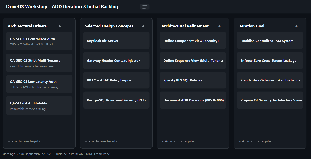
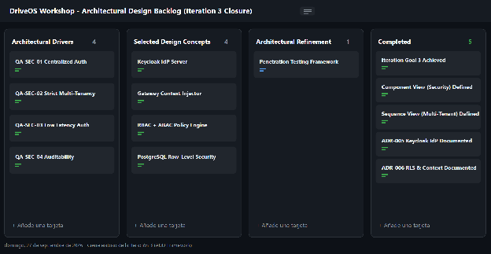

### **4.3.3.7 Analysis of Current Design and Review Iteration Goal (Kanban Board)** {#4.3.3.7-analysis-of-current-design-and-review-iteration-goal-(kanban-board)}

**1\. Tablero Kanban al INICIO de la Iteración 3 (ADD Iteration 3 Initial Backlog)**

**2\. Tablero Kanban al CIERRE de la Iteración 3 (ADD Iteration 3 Completed)**  

| Not Addressed | Partially Addressed | Completely Addressed | Design decisions made during the iteration |
| ----- | ----- | ----- | ----- |
| • QA-02 (Trazabilidad OpenTelemetry) • QA-08 (Interoperabilidad SUNAT) • CON-3 (Facturación electrónica) | • QA-09 (Resiliencia en integraciones externas) | • QA-05 (Aislamiento RLS 0% fuga) • QA-06 (Autenticación Keycloak OIDC) • QA-07 (Auditoría de acciones) • US23 (Gestión de Roles RBAC) | • ADR-006: Keycloak IdP con OIDC/OAuth 2.0 • ADR-007: Multi-Tenancy con Row-Level Security |

## Relaciones

- Padre: [[capitulo-iv/4.3.3.iteracion-3-seguridad-centralizada-autenticacion-autorizacion-iam-y-aislamiento-multi-inquilino-multi-tenancy|4.3.3. Iteración 3: Seguridad Centralizada, Autenticación/Autorización IAM y Aislamiento Multi-Inquilino (Multi-Tenancy)]]
- Índice: [[preliminares/contenido|CONTENIDO]]
