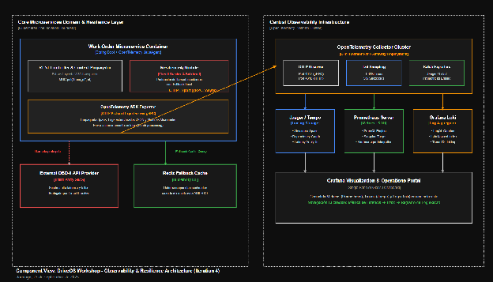
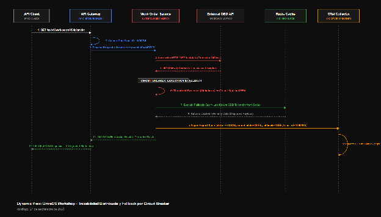

### **4.3.4.6 Sketch Views (C4 & UML) and Record Design Decisions** {#4.3.4.6-sketch-views-(c4-&-uml)-and-record-design-decisions}

**1\. Vista de Componentes (C4 Component View \- Observability & Resilience Architecture)**  
El siguiente diagrama ilustra la topología interna del sistema de observabilidad y resiliencia, mostrando la interacción entre los microservicios, la capa de instrumentación OTel, los módulos de resiliencia y el cluster de colectores centralizados:

**2\. Vista Dinámica: Diagrama de Secuencia (Dynamic View \- Distributed Tracing & Circuit Breaker Fallback Flow)**  
Este diagrama detalla la interacción en tiempo real ante la falla de un servicio externo, mostrando cómo el *Circuit Breaker* intercepta el error, ejecuta un *Fallback* y reporta la telemetría correlacionada al *OpenTelemetry Collector*

**Registros de Decisión Arquitectónica (ADR) \- Iteración 4**

#### 

* 

| ADR | Decisión Tomada | Drivers Relacionados | Componente Afectado | Alternativa Descartada | Consecuencia / Impacto |
| ----- | ----- | ----- | ----- | ----- | ----- |
| ADR-008 | Adopción de OpenTelemetry y Stack LGTM para Observabilidad Distribuida. | QA-02, CRN-2 | Todos los Microservicios de DriveOS & OTel Collector | Soluciones propietarias cerradas (Datadog) o herramientas aisladas. | Observabilidad unificada de extremo a extremo sin dependencia de proveedor; consumo adicional mínimo de memoria (\< 25 MB/pod). |
| ADR-009 | Implementación de Circuit Breaker y Fallback con Resilience4j en Integration Hub. | QA-03, QA-09, CON-5 | Integration Hub & API Gateway | Reintentos indefinidos o llamadas síncronas desprotegidas. | Evita el bloqueo de hilos y caídas en cascada ante fallas de terceros; requiere diseñar respuestas degradadas aceptables para el usuario. |

  *

## Relaciones

- Padre: [[capitulo-iv/4.3.4-iteracion-4-observabilidad-distribuida-trazabilidad-de-extremo-a-extremo-opentelemetry-metricas-en-tiempo-real-y-resiliencia-avanzada-circuit-breaker-rate-limiting|4.3.4 Iteración 4: Observabilidad Distribuida, Trazabilidad de Extremo a Extremo (OpenTelemetry), Métricas en Tiempo Real y Resiliencia Avanzada (Circuit Breaker & Rate Limiting)]]
- Índice: [[preliminares/contenido|CONTENIDO]]
