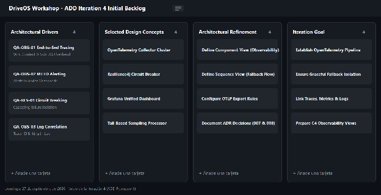
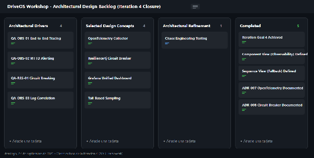

### **4.3.4.7 Analysis of Current Design and Review Iteration Goal (Kanban Board)** {#4.3.4.7-analysis-of-current-design-and-review-iteration-goal-(kanban-board)}

**1\. Tablero Kanban al INICIO de la Iteración 4 (ADD Iteration 4 Initial Backlog)**  

**2\. Tablero Kanban al CIERRE de la Iteración 4 (ADD Iteration 4 Completed)**

| Not Addressed | Partially Addressed | Completely Addressed | Design decisions made during the iteration |
| ----- | ----- | ----- | ----- |
| • QA-08 (Interoperabilidad SUNAT) • CON-3 (Facturación electrónica SUNAT) | • Ninguno (Fase de integración completada) | • QA-02 (Trazabilidad OpenTelemetry) • QA-03 (Disponibilidad 99.9%) • QA-09 (Resiliencia Circuit Breaker) • CRN-2 (Monitoreo LGTM centralizado) • CON-5 (Tolerancia a latencia de red) • Chaos Engineering Testing (Completado) | • ADR-008: OpenTelemetry y Stack LGTM • ADR-009: Circuit Breaker y Fallback Resilience4j |

## Relaciones

- Padre: [[capitulo-iv/4.3.4-iteracion-4-observabilidad-distribuida-trazabilidad-de-extremo-a-extremo-opentelemetry-metricas-en-tiempo-real-y-resiliencia-avanzada-circuit-breaker-rate-limiting|4.3.4 Iteración 4: Observabilidad Distribuida, Trazabilidad de Extremo a Extremo (OpenTelemetry), Métricas en Tiempo Real y Resiliencia Avanzada (Circuit Breaker & Rate Limiting)]]
- Índice: [[preliminares/contenido|CONTENIDO]]
