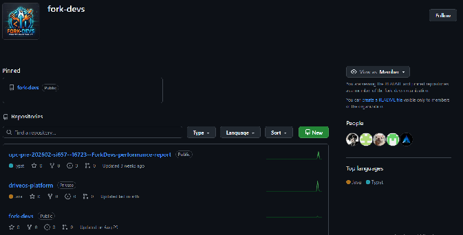

### ***5.2 Software Configuration Management*** {#5.2-software-configuration-management}

En esta sección, el equipo de ingeniería de ForkDevs establece las decisiones, estándares, herramientas y políticas de configuración de software que aseguran la consistencia técnica, trazabilidad y reproducibilidad del ecosistema DriveOS Workshop a lo largo de todo su ciclo de vida.

### 

### 

### 

###

## Relaciones

- Padre: [[capitulo-v/capitulo-v-product-implementation-validation-deployment|Capítulo V: Product Implementation, Validation & Deployment]]
- Hijos:
  - [[capitulo-v/5.2.1-software-development-environment-configuration|5.2.1 Software Development Environment Configuration]]
  - [[capitulo-v/5.2.2-source-code-management|5.2.2 Source Code Management]]
  - [[capitulo-v/5.2.3-source-code-style-guide-conventions|5.2.3 Source Code Style Guide & Conventions]]
  - [[capitulo-v/5.2.4-software-deployment-configuration|5.2.4 Software Deployment Configuration]]
- Índice: [[preliminares/contenido|CONTENIDO]]
