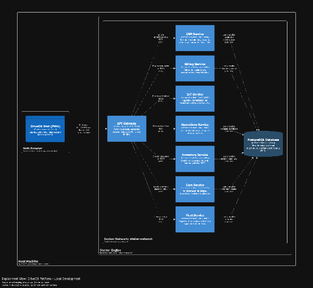

### ***5.2.4 Software Deployment Configuration*** {#5.2.4-software-deployment-configuration}

La configuración de despliegue de DriveOS Platform representa la topología de ejecución física y de contenedores requerida para el entorno local, modelada bajo la vista C4 Model Deployment View mediante Structurizr y orquestada por Docker Compose:

### ******

**• Nodo Host Machine (Máquina del Desarrollador):** Estación de trabajo local (Windows / Linux / macOS) que aloja el entorno de desarrollo y pruebas.  
\- Subnodo Web Browser: Navegador cliente (Google Chrome / Microsoft Edge) que ejecuta la Single Page Application 'DriveOS Web (PWA)' en Angular 21, comunicándose hacia el backend mediante peticiones HTTPS/REST en el puerto 8080\.  
\- Subnodo Docker Engine (Runtime 25.x): Motor de virtualización a nivel de sistema operativo que aloja y gestiona los contenedores de software.

**• Red Virtual Aislada (Docker Network: atelier-network):**  Red de tipo bridge que interconecta internamente los contenedores de la plataforma sin exponer puertos innecesarios hacia el exterior:  
1\. Contenedor api-gateway: Único punto de acceso expuesto hacia la máquina host (mapeo de puerto 8080:8080), actuando como proxy inverso hacia la red interna.  
2\. Contenedores de Microservicios Core: Los siete servicios de backend ('iam-service' en :8081, 'billing-service' en :8082, 'iot-service' en :8083, 'operations-service' en :8084, 'inventory-service' en :8085, 'core-service' en :8086 y 'fleet-service' en :8087) comunicados directamente con el API Gateway mediante HTTP.  
3\. Contenedor postgres: Instancia de PostgreSQL 16 exponiendo el puerto 5432 con almacenamiento persistente en el volumen 'pgdata', conectado a los microservicios mediante JDBC.
