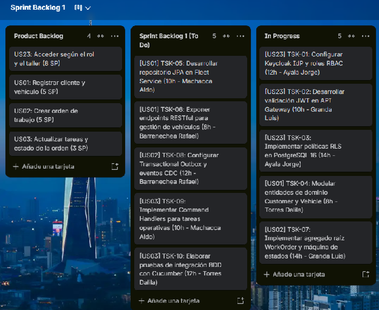

### ***5.3.1.1 Sprint Backlog 1*** {#5.3.1.1-sprint-backlog-1}

Objetivo del Sprint 1: Establecer la infraestructura de seguridad e identidad (IAM) con tokens JWT y control RBAC, desplegar el API Gateway con validación perimetral y desarrollar la capacidad transaccional de registro de vehículos y apertura de órdenes de trabajo.

Enlace público al Tablero de Trello del Sprint 1: [https\://trello.com/b/Y4Ysb7Sj/sprint-backlog-1](https://trello.com/b/Y4Ysb7Sj/sprint-backlog-1)

A continuación, se presenta la tabla de control de estado del Sprint Backlog 1, detallando las User Stories asignadas, tareas técnicas de ingeniería, estimación en horas y responsables:

| User Story ID | Título de la Historia | Work-Items / Tareas de Ingeniería (Tasks) | Horas Est. | Responsable | Estado |
| ----- | ----- | ----- | ----- | ----- | ----- |
| US23 | Acceder según el rol y el taller | TSK-01: Implementar AuthenticationController y generación de JWT en iam-service. | 12h | Ayala Fernandez, Jorge | Done |
| US23 | Acceder según el rol y el taller | TSK-02: Desarrollar GatewayDispatcherController con NimbusJwtValidator en api-gateway. | 10h | Granda Ibarra, Luis | Done |
| US23 | Acceder según el rol y el taller | TSK-03: Implementar políticas de Row-Level Security (RLS) en base de datos PostgreSQL. | 14h | Ayala Fernandez, Jorge | Done |
| US01 | Registrar cliente y vehículo | TSK-04: Implementar CustomersController y creación de clientes en core-service. | 8h | Torres Sanchez, Dalila | Done |
| US01 | Registrar cliente y vehículo | TSK-05: Desarrollar CustomerRegistrationsController y appointments en fleet-service. | 10h | Machacca Soto, Aldo | Done |
| US01 | Registrar cliente y vehículo | TSK-06: Exponer vehículos y vinculación OBD-II en iot-service / VehiclesController. | 8h | Barrenechea Bustamante, Rafael | Done |
| US02 | Crear orden de trabajo | TSK-07: Implementar WorkOrdersController y agregado WorkOrder en operations-service. | 14h | Granda Ibarra, Luis | Done |
| US02 | Crear orden de trabajo | TSK-08: Configurar catálogo de servicios y tareas operativas en ServicesController. | 12h | Barrenechea Bustamante, Rafael | Done |
| US03 | Actualizar tareas y estado de la orden | TSK-09: Desarrollar WorkOrderTasksController para agregar tareas y productos a la orden. | 10h | Machacca Soto, Aldo | Done |
| US03 | Actualizar tareas y estado de la orden | TSK-10: Elaborar pruebas de integración y flujos E2E con MockMvc y Playwright. | 12h | Torres Sanchez, Dalila | Done |

###

## Relaciones

- Padre: [[capitulo-v/5.3.1-sprint-1|5.3.1 Sprint 1]]
- Índice: [[preliminares/contenido|CONTENIDO]]
