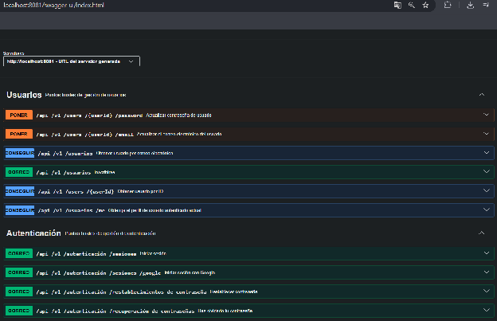
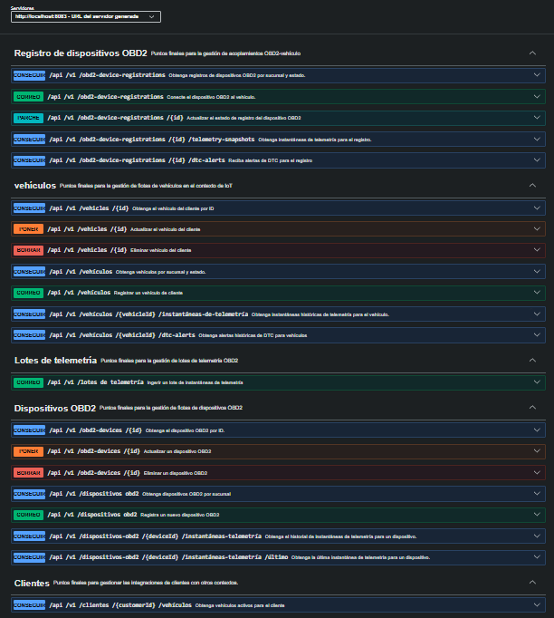
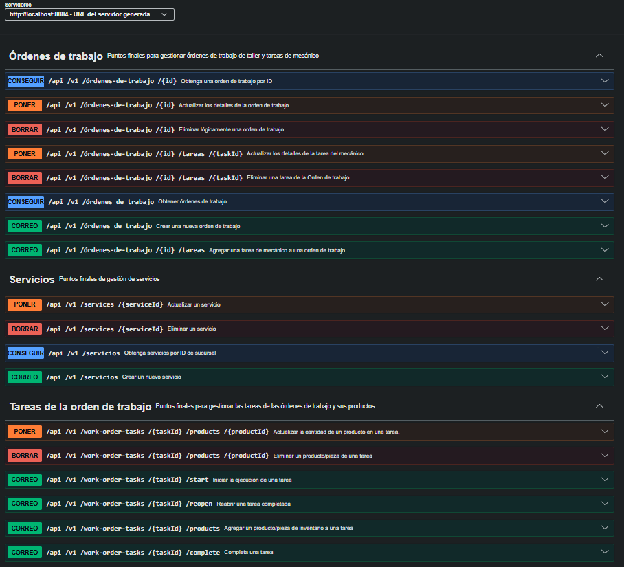

### ***5.3.1.5 Microservices Documentation Evidence for Sprint Review*** {#5.3.1.5-microservices-documentation-evidence-for-sprint-review}

Todos los endpoints del Sprint 1 se encuentran documentados bajo la especificación OpenAPI 3.0 mediante Springdoc OpenAPI / Swagger UI interactivo:

URLs locales de Swagger UI (OpenAPI 3.0):

• API Gateway (Enrutador Central): http\://localhost:8080/swagger-ui/index.html

• IAM Service (Autenticación y Usuarios): http\://localhost:8081/swagger-ui/index.html

• IoT Service (Vehículos y Telemetría): http\://localhost:8083/swagger-ui/index.html

• Operations Service (Órdenes de Trabajo y Tareas): http\://localhost:8084/swagger-ui/index.html

| Microservicio | Método | Ruta de Endpoint | Resumen de Operación | Parámetros / Request Body | Códigos HTTP de Respuesta |
| ----- | ----- | ----- | ----- | ----- | ----- |
| api-gateway | GET | /api/v1/gateway/status | Consulta de salud del API Gateway | Ninguno | 200 OK (StatusResponse) |
| iam-service | POST | /api/v1/authentication/sign-in | Inicio de sesión y entrega de JWT | Body: SignInResource (username, password) | 200 OK (AuthenticatedUserResource), 400 Bad Request |
| iam-service | POST | /api/v1/authentication/sign-up | Registro de nuevo usuario | Body: SignUpResource (username, password, roles) | 201 Created (UserResource), 409 Conflict |
| core-service | POST | /api/v1/customers | Registro de nuevo cliente | Body: CreateCustomerResource (fullName, email) | 201 Created (CustomerResource), 400 Bad Request |
| iot-service | POST | /api/v1/vehicles | Alta de vehículo en taller | Body: RegisterVehicleResource (plate, vin, model) | 201 Created (VehicleResource), 409 Conflict |
| operations-service | POST | /api/v1/work-orders | Apertura de orden de trabajo | Body: CreateWorkOrderResource (vehicleId, notes) | 201 Created (WorkOrderResource), 400 Bad Request |
| operations-service | GET | /api/v1/work-orders/{id} | Consulta de orden por identificador | Path: id (Long/UUID). Header: Bearer Token | 200 OK (WorkOrderResource), 404 Not Found |
| operations-service | POST | /api/v1/work-orders/{id}/tasks | Asignar tarea operativa a orden | Body: AddTaskResource (serviceId, employeeId) | 201 Created (WorkOrderTaskResource), 404 Not Found |

###
