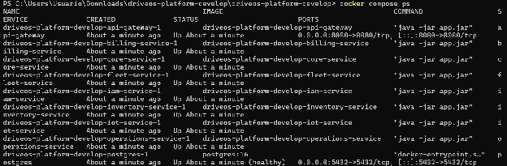
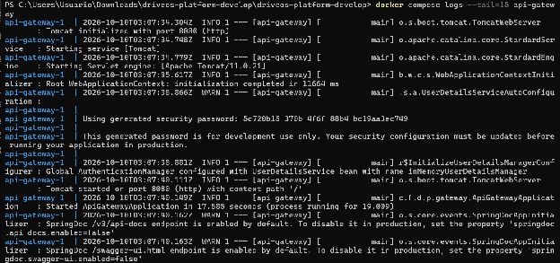

### ***5.3.1.6 Software Deployment Evidence for Sprint Review*** {#5.3.1.6-software-deployment-evidence-for-sprint-review}

El despliegue de los servicios del Sprint 1 se realizó mediante Docker Compose, levantando la base de datos PostgreSQL 16 y los microservicios en contenedores:

**• Base de Datos:**  Contenedor 'postgres:16' exponiendo el puerto 5432 y persistiendo datos en volumen pgdata.

**• Gateway:**  Contenedor 'api-gateway' en puerto 8080 enrutando peticiones a los servicios internos.

**• Microservicios:**  Contenedores de 'iam-service' (:8081), 'operations-service' (:8084), 'core-service' (:8086) y 'iot-service' (:8083) en ejecución continua con healthcheck en estado UP.

###
