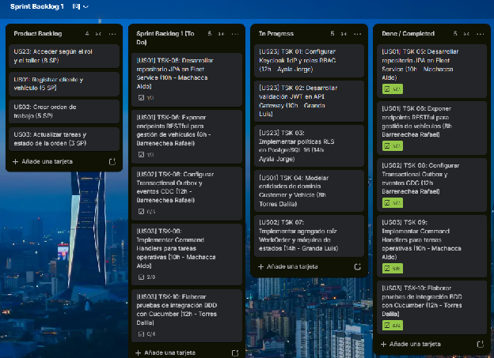

### ***5.3.1.8 Kanban Board***  {#5.3.1.8-kanban-board}

Al cierre del Sprint 1, el equipo completó el 100% de los 21 Story Points asignados (US23, US01, US02 y US03), cerrando todas las tareas en el tablero oficial de Trello:

Enlace público al Tablero de Cierre: [https\://trello.com/b/Y4Ysb7Sj/sprint-backlog-1](https://trello.com/b/Y4Ysb7Sj/sprint-backlog-1)

###

## Relaciones

- Padre: [[capitulo-v/5.3.1-sprint-1|5.3.1 Sprint 1]]
- Índice: [[preliminares/contenido|CONTENIDO]]
